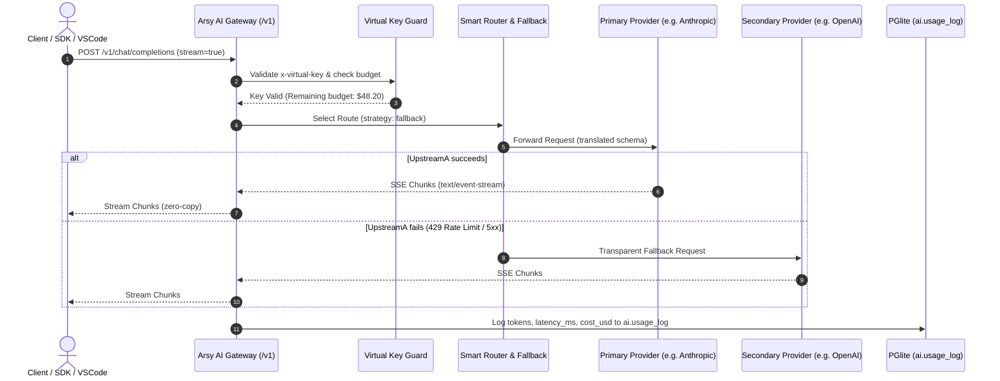

# DESIGN: AGI Platform & AI Gateway Foundation

## 1. System Interaction Architecture

The AI Gateway serves as the single ingress point for all AI capabilities in the ecosystem. Internal micro-apps, background jobs, external developers, and the VS Code extension all communicate through this layer.



---

## 2. API Contract Specifications

### 2.1 Unified Chat Completion Endpoint
- **Path**: `POST /v1/chat/completions`
- **Headers**:
  - `Content-Type: application/json`
  - `Authorization: Bearer <token>` or `x-virtual-key: <key_hash>`
- **Request Body**:
  ```json
  {
    "model": "dx-reasoning",
    "messages": [
      { "role": "system", "content": "You are a MoonWitness autonomous agent." },
      { "role": "user", "content": "Analyze the system state." }
    ],
    "temperature": 0.7,
    "stream": true
  }
  ```
- **Response (when `stream: false`)**:
  ```json
  {
    "id": "chatcmpl-9238491823",
    "object": "chat.completion",
    "created": 1730645400,
    "model": "dx-reasoning",
    "choices": [
      {
        "index": 0,
        "message": {
          "role": "assistant",
          "content": "Analysis complete."
        },
        "finish_reason": "stop"
      }
    ],
    "usage": {
      "prompt_tokens": 18,
      "completion_tokens": 24,
      "total_tokens": 42
    }
  }
  ```
- **Response (when `stream: true`)**:
  - MIME: `text/event-stream`
  - Chunks: `data: {"id":"...","choices":[{"delta":{"content":"..."}}]}\n\n`
  - Terminal chunk: `data: [DONE]\n\n`

### 2.2 Provider Management Endpoints
- `GET /v1/gateway/providers`: Returns list of configured AI providers and health status.
- `POST /v1/gateway/providers`: Create or update an upstream provider configuration.
- `GET /v1/gateway/routes`: Returns list of routing strategies and fallback chains.
- `GET /v1/gateway/usage`: Returns aggregated token and cost telemetry for the current tenant.

---

## 3. UI Composition: Headquarter AI Control Plane

Located at `apps/headquarter/src/app/(dashboard)/ai-gateway/page.tsx`, adhering strictly to `@moonwitness/ui`:

### 3.1 Layout Sections
1. **Header Area**:
   - Page title: "AI Gateway & Infrastructure"
   - Active status indicator (Online / Degraded / Offline)
   - Quick Action: "Create Virtual Key" modal trigger
2. **Provider Telemetry Grid (3 Cards)**:
   - Card 1: Active Upstream Providers (OpenAI, Anthropic, Gemini, Ollama) with latency badges.
   - Card 2: 24h Token Volume (Input / Output / Total) with delta indicator.
   - Card 3: Estimated Cost USD with monthly budget utilization progress bar.
3. **Routing Strategy Matrix**:
   - Visual display of active routes (`dx-fast`, `dx-default`, `dx-reasoning`) and their fallback sequence.
4. **Live Usage Logs Table**:
   - Columns: Timestamp, Model, Virtual Key Prefix, Tokens, Cost, Latency, Status.
   - Filtering: By model, status, and date range.
   - UI States: Loading skeleton, Empty state, and Error retry alert.

