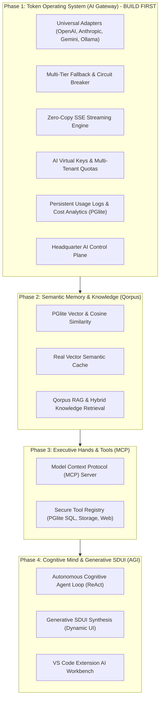

# SPEC: AGI Platform & AI Gateway Foundation

## 1. Problem Statement & Deep Architectural Insight
To evolve A-L-L-A-H.COM and the MoonWitness platform into a true **Artificial General Intelligence (AGI) platform and Enterprise AI Gateway**, we must determine the exact sequence of engineering construction.

An AGI platform cannot be built in vacuum. High-level agentic capabilities (autonomous reasoning, multi-step problem solving, long-term memory, and self-directed tool execution) fundamentally depend on an underlying token-routing and inference substrate. 

If agents are deployed before the AI Gateway is built:
1. Provider outages or rate limits (HTTP 429/529) cause unrecoverable agent loop crashes.
2. Unmetered token consumption leads to catastrophic budget drains.
3. Lack of zero-copy streaming (SSE) results in unresponsive client experiences.
4. Hardcoding a single model vendor creates platform fragility.
5. Inability to execute tools with schema normalization prevents autonomous action.

**The Foundational Conclusion**:
The **AI Gateway & Unified Multi-Provider Routing Engine** must be built **FIRST** as Phase 1. It serves as the resilient operating system through which all future cognitive layers (Memory, Tools, Agent Loop, and Generative SDUI) communicate.

---

## 2. Phase Breakdown & Evolutionary Staircase

### Phase 1: Enterprise Multi-Provider AI Gateway & Unified Routing Engine (Build First)
Transform `packages/arsy-plugin-llm-gateway` from an in-memory mock proxy into a production-grade AI Gateway fully wired into `@allah/arsy-orm` and `addons/mw_llm_router`:
- **Universal Provider Adapters**:
  - OpenAI-compatible adapter (OpenAI, DeepSeek, Groq, Together, vLLM).
  - Anthropic Messages adapter (Claude 3.5 Sonnet, Claude 3.7 Sonnet, Claude Opus).
  - Google Gemini adapter (Gemini 2.5 Flash, Gemini 2.5 Pro via REST).
  - Local/Self-hosted adapter (Ollama, local vLLM).
- **ORM Integration**:
  - Connect runtime to `ai.provider`, `ai.model`, `ai.route`, `ai.virtual_key`, and `ai.usage_log`.
  - Database-driven provider configuration and dynamic routing strategies (Fallback Sequence, Lowest Cost, Weighted Round Robin).
- **True Server-Sent Events (SSE) Streaming**:
  - Zero-copy chunk streaming for `/v1/chat/completions` with `stream: true`.
  - Accurate token counting on stream completion.
- **Resilience & Circuit Breaking**:
  - Automatic failover when primary provider returns 429, 500, or 503.
  - Health check probes and automated provider degradation detection.
- **Virtual Key Authentication & Metering**:
  - Header-based `x-virtual-key` authentication tied to tenant `company_id`.
  - Enforced rate limits (RPM, TPM) and monthly USD budget ceilings.
  - Granular logging into `ai_usage_log` (prompt tokens, completion tokens, latency ms, calculated USD cost).
- **Control Plane & Client SDK**:
  - `@allah/sdk`: Add `chatStream()`, model catalog retrieval, and usage query methods.
  - `apps/headquarter`: AI Gateway management dashboard (Providers status, Active Routes, Virtual Keys, Live Usage Analytics).

### Phase 2: Cognitive Memory & Knowledge Subsystem (Qorpus RAG)
- **Vector Embedding Engine**: Add `/v1/embeddings` endpoint across providers.
- **Real Vector Semantic Cache**: Persistent semantic cache using cosine similarity threshold (e.g. 0.95), reducing inference costs by up to 60%.
- **Qorpus Knowledge Store (`addons/mw_qorpus`)**:
  - Multi-source document chunking (Markdown, Code, Documentation).
  - SHA-256 deduplication and hybrid retrieval (lexical BM25 + dense vector).
  - Conversation thread working memory stored in PGlite.

### Phase 3: Executive Tools & Model Context Protocol (MCP)
- **Tool Schema Normalization**: Bidirectional translation of JSON Schema tool definitions across OpenAI, Anthropic, and Gemini formats.
- **Arsy Native Tools**:
  - Parameterized PGlite safe query tool.
  - Content-addressed storage read/write tool.
  - SSRF-guarded web retrieval tool.
- **MCP Server**: Fastify MCP implementation allowing IDEs and external agents to invoke platform tools securely.

### Phase 4: Autonomous Agentic Loop & Generative SDUI (The AGI Synthesis)
- **ReAct Cognitive Loop**: Multi-turn planning, reasoning, action, and observation engine.
- **Generative SDUI**: Server-driven UI component synthesis directly rendering rich interactive layouts in Dock and Headquarter.
- **Developer Extension Integration**: Full integration with `allah-vscode-extension` for autonomous spec, task, and codebase generation.

---

## 3. Acceptance Criteria
1. Gateway successfully routes completions and streams SSE across OpenAI, Anthropic, and Google Gemini with normalized interfaces.
2. If primary provider fails or returns 429, gateway transparently falls back to secondary provider without breaking client connection.
3. Every request made with an AI Virtual Key updates `ai_usage_log` with verified token count and USD cost.
4. Headquarter displays real-time AI provider health, virtual key metrics, and usage charts.
5. All TypeScript typechecks and build gates pass 100% (`pnpm arsy:build`, `pnpm headquarter:build`, `pnpm dock:build`, `pnpm id:build`).
6. `pnpm docs:check` validates documentation contracts with 100/100 score.

