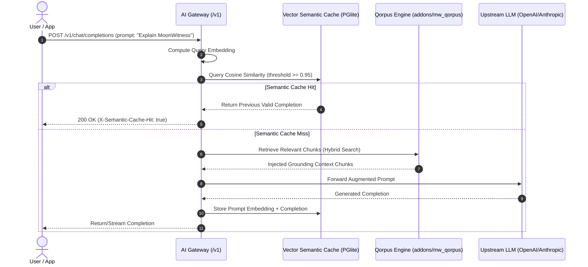

# DESIGN: Phase 2 - Cognitive Memory, Qorpus RAG & Vector Semantic Cache

## 1. System Interaction Architecture



---

## 2. API Contract Specifications

### 2.1 Embeddings Endpoint
- **Path**: `POST /v1/embeddings`
- **Request**:
  ```json
  {
    "model": "text-embedding-3-small",
    "input": ["Explain the MoonWitness architecture", "What is Arsy?"]
  }
  ```
- **Response**:
  ```json
  {
    "object": "list",
    "data": [
      {
        "object": "embedding",
        "index": 0,
        "embedding": [0.0123, -0.0456, 0.0891, 0.0032]
      }
    ],
    "model": "text-embedding-3-small",
    "usage": {
      "prompt_tokens": 12,
      "total_tokens": 12
    }
  }
  ```

### 2.2 Qorpus Knowledge Ingestion & Retrieval Endpoints
- **Ingestion**: `POST /v1/qorpus/ingest`
  ```json
  {
    "title": "A-L-L-A-H.COM System Architecture",
    "category": "architecture",
    "content": "# Markdown content of documentation...",
    "source": "docs/architecture.md"
  }
  ```
- **Search**: `POST /v1/qorpus/search`
  ```json
  {
    "query": "How does the Smart LLM router handle failover?",
    "limit": 5,
    "min_score": 0.75
  }
  ```
- **Search Response**:
  ```json
  {
    "success": true,
    "data": {
      "chunks": [
        {
          "id": 102,
          "document_title": "AI Gateway Architecture",
          "content": "The router maintains an active circuit breaker...",
          "score": 0.92,
          "category": "architecture"
        }
      ]
    }
  }
  ```

---

## 3. UI Composition: Headquarter Knowledge Explorer
Located at `apps/headquarter/src/app/knowledge/page.tsx` using `@moonwitness/ui`:
1. **Search & Query Bar**: Live hybrid search input displaying scored document chunks.
2. **Document Library Grid**: List of ingested documents with SHA-256 digests and chunk counts.
3. **Semantic Cache Telemetry**: Card showing total cache entries, storage volume, and hit rate percentage.

