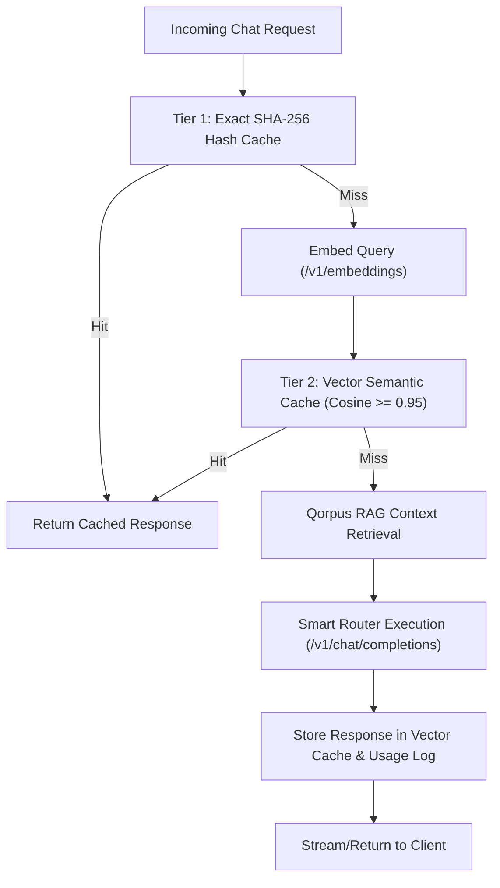

# SPEC: Phase 2 - Cognitive Memory, Qorpus RAG & Vector Semantic Cache

## 1. Problem Statement & Architecture Goals
Following the successful completion of Phase 1 (Universal AI Gateway & Resilient Routing), the platform requires **long-term cognitive memory, knowledge retrieval, and persistent semantic caching**.

Without Phase 2:
1. The gateway can only perform exact string hash caching, missing semantic equivalents (e.g. "What is MoonWitness?" vs "Explain MoonWitness platform") and paying full inference cost.
2. The AI has no memory or grounding in platform lore, codebase architecture, or documentation.
3. Multi-turn interactions cannot persist context across sessions without resending complete histories.

Phase 2 introduces:
- `/v1/embeddings` endpoint with multi-provider normalization (OpenAI & Gemini).
- Real vector distance calculation (cosine similarity) in embedded PGlite.
- Vector Semantic Cache with configurable similarity threshold ($s \ge 0.95$).
- `addons/mw_qorpus`: Knowledge store with document chunking, SHA-256 deduplication, and hybrid search (lexical + dense vector).
- Persistent conversation threads and episodic memory.

---

## 2. Technical Requirements & Deliverables

### 2.1 Multi-Provider Embeddings (`/v1/embeddings`)
- Support `POST /v1/embeddings` in `packages/arsy-plugin-llm-gateway`.
- Normalize OpenAI (`text-embedding-3-small`, `text-embedding-3-large`) and Google Gemini (`text-embedding-004`).
- Return standard vector array format: `{ object: 'list', data: [{ embedding: number[] }] }`.

### 2.2 Vector Semantic Cache in PGlite
- Table `ai_semantic_cache`: `id`, `prompt_hash`, `prompt_text`, `embedding JSON/VECTOR`, `response_json`, `model`, `hit_count`, `expires_at`.
- Cosine similarity function implemented in SQL / JS query helper:
  $$\text{Cosine Similarity} = \frac{\mathbf{A} \cdot \mathbf{B}}{\|\mathbf{A}\| \|\mathbf{B}\|}$$
- Return cached completion when $\text{similarity} \ge 0.95$.

### 2.3 Qorpus Knowledge Ingestion Addon (`addons/mw_qorpus`)
- Models:
  - `qorpus.document`: Title, category (canon, architecture, contract, code), source path, SHA-256 digest.
  - `qorpus.chunk`: Document relation, chunk index, content text, token count, embedding vector.
- Ingestion pipeline: Markdown / text chunking with sliding window (512 tokens with 64-token overlap).
- Hybrid search API: `POST /v1/qorpus/search` (combines ILIKE/BM25 text matching and vector similarity).

### 2.4 Conversation Threads & Episodic Memory
- Models:
  - `ai.thread`: User relation, title, metadata, active model.
  - `ai.message`: Thread relation, role, content, token count, create_date.
- Automatic compaction: If thread messages exceed context limit, summarize older turns while preserving recent history.

---

## 3. Acceptance Criteria
1. `/v1/embeddings` generates vectors correctly across configured providers.
2. Semantic cache returns hits for phrased questions with $\ge 95\%$ semantic similarity without calling upstream provider.
3. Documents in the repository can be ingested into `qorpus.document` and `qorpus.chunk`.
4. `POST /v1/qorpus/search` returns ranked chunks with relevance scores.
5. All builds pass (`dock:build`, `headquarter:build`, `id:build`, `arsy:build`, `docs:check`).

