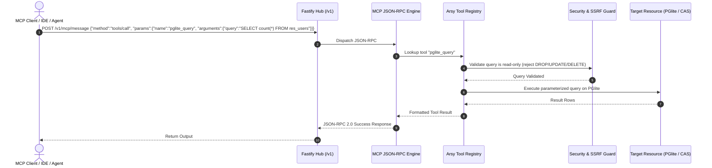

# DESIGN: Phase 3 - Executive Hands & Model Context Protocol (MCP) Tools

## 1. System Interaction Architecture

---

## 2. Tool Interfaces & Definitions

### 2.1 `pglite_query`
- **Description**: Safely query the embedded PGlite relational database.
- **Safety Constraints**: `SELECT` queries only. Rejects `DROP`, `DELETE`, `UPDATE`, `INSERT`, `ALTER`, `TRUNCATE`.
- **Arguments**:
  - `query` (string, required): SQL query string with optional parameters.
  - `params` (array, optional): Parameterized values (`$1`, `$2`, etc.).

### 2.2 `storage_cas`
- **Description**: Read or write content-addressed blobs via SHA-256 digest.
- **Arguments**:
  - `action` ('get' | 'put', required).
  - `content` (string, required for 'put').
  - `digest` (string, required for 'get').

### 2.3 `web_fetch`
- **Description**: Fetch external web page or JSON endpoint.
- **Safety Constraints**: Strict SSRF guard blocking localhost, loopback, and RFC1918 private IP subnets.
- **Arguments**:
  - `url` (string, required): Target HTTP/HTTPS URL.
  - `max_bytes` (number, default: 50000).

### 2.4 `qorpus_retrieve`
- **Description**: Semantic hybrid search over MoonWitness documentation, canon, and code.
- **Arguments**:
  - `query` (string, required): Question or search terms.
  - `limit` (number, default: 5).
  - `min_score` (number, default: 0.7).

---

## 3. UI Composition: Headquarter Tools & MCP Dashboard
Located at `apps/headquarter/src/app/tools/page.tsx` using `@moonwitness/ui`:
1. **MCP Status & Endpoint Connection**: Card showing active MCP connection endpoint (`/v1/mcp/sse`), protocol version, and connected clients.
2. **Tool Registry Catalog**: Interactive cards for each tool showing input schema, execution permissions, and test trigger.
3. **Interactive Tool Execution Sandbox**: Form allowing operators to test tool execution with custom inputs and view formatted outputs.
4. **Tool Execution Audit Log**: Table recording tool calls, executing actors, duration in ms, and success/failure statuses.

