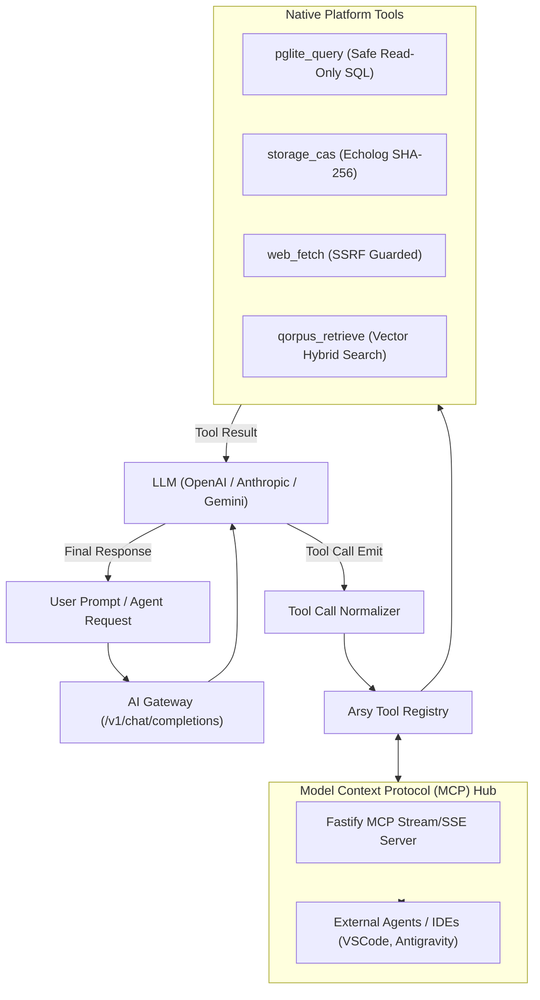

# SPEC: Phase 3 - Executive Hands & Model Context Protocol (MCP) Tools

## 1. Problem Statement & Architecture Goals
Following the completion of:
- **Phase 1**: Enterprise Multi-Provider AI Gateway & Resilient Fallback Routing (commit `bbf93bc`)
- **Phase 2**: Cognitive Memory, Qorpus RAG & Vector Semantic Caching (commit `c01b5f8`)

The platform now possesses an inference operating system and persistent knowledge memory. However, it still lacks **executive hands**: the ability for models to interact with the external world and internal platform capabilities through structured function calls and standard protocols.

### Objectives of Phase 3:
1. **Tool Normalization in Gateway**: Standardize JSON Schema tool definitions (`tools` and `tool_choice`) across OpenAI, Anthropic, and Google Gemini.
2. **Arsy Native Tools Registry**: Provide secure, parameterized platform tools:
   - `pglite_query`: Parameterized read-only SQL queries against tenant PGlite tables.
   - `storage_cas`: Store and fetch content-addressed assets (SHA-256 echolog).
   - `web_fetch`: Sandboxed external HTTP fetch with SSRF guard.
   - `qorpus_retrieve`: Dynamic grounding context search.
3. **Fastify MCP Server**: Expose tools via the Model Context Protocol (MCP) over Stream/SSE so IDEs (Antigravity, Cursor, VS Code) and external agents can directly execute platform tools.
4. **Interactive Headquarter Tool Console**: Inspect active tools, test executions, and audit tool invocation logs.



---

## 2. API Contract Specifications

### 2.1 Tool Calling Contract in `/v1/chat/completions`
- Request accepts standard OpenAI `tools` array:
  ```json
  {
    "model": "dx-reasoning",
    "messages": [{ "role": "user", "content": "How many users are registered?" }],
    "tools": [
      {
        "type": "function",
        "function": {
          "name": "pglite_query",
          "description": "Execute safe parameterized read-only SQL query",
          "parameters": {
            "type": "object",
            "properties": {
              "query": { "type": "string" }
            },
            "required": ["query"]
          }
        }
      }
    ]
  }
  ```
- If the upstream model emits a tool call, response contains:
  ```json
  {
    "choices": [
      {
        "index": 0,
        "message": {
          "role": "assistant",
          "content": null,
          "tool_calls": [
            {
              "id": "call_123",
              "type": "function",
              "function": {
                "name": "pglite_query",
                "arguments": "{\"query\":\"SELECT count(*) FROM res_users\"}"
              }
            }
          ]
        },
        "finish_reason": "tool_calls"
      }
    ]
  }
  ```

### 2.2 Model Context Protocol (MCP) Endpoints
- `GET /v1/mcp/sse`: Server-Sent Events stream for MCP client connections.
- `POST /v1/mcp/message`: Ingress endpoint for JSON-RPC 2.0 messages:
  - `tools/list`: Enumerate all registered platform tools.
  - `tools/call`: Execute a specified tool with arguments and return output text/json.

---

## 3. Acceptance Criteria
1. Tool call definitions are normalized across OpenAI, Anthropic, and Gemini adapters.
2. Built-in tools (`pglite_query`, `storage_cas`, `web_fetch`, `qorpus_retrieve`) execute safely with input validation.
3. SQL tool enforces read-only operations (`SELECT` only, rejecting `DROP`, `DELETE`, `UPDATE`, `INSERT`).
4. External MCP clients can discover and call tools via `/v1/mcp/sse` and `/v1/mcp/message`.
5. All ecosystem builds pass 100% (`dock:build`, `headquarter:build`, `id:build`, `arsy:build`, `docs:check`).

