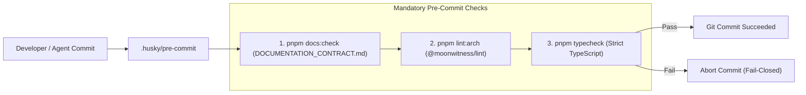

# DESIGN: Strict Monorepo Architectural Linter, Typecheck & Document Correlation

## 1. Architectural Guard Pipeline

---

## 2. Linter Rule Specification (`@moonwitness/lint`)

### 2.1 Rule: `ui-purity`
- **Scope**: `apps/**/*.{tsx,jsx}`
- **Constraint**: Interactive elements must be imported from `@moonwitness/ui`.
- **Blocked Patterns**:
  - Raw HTML buttons: `<button ...>` (unless defined inside `packages/ui` itself).
  - Raw HTML text inputs: `<input type="text" ...>` or `<input className="..." ...>` without using `<Input>` component.
- **Allowed Solution**: `import { Button, Input } from '@moonwitness/ui';`

### 2.2 Rule: `single-orm`
- **Scope**: Entire codebase
- **Constraint**: Zero ORM overlap. Only `@allah/arsy-orm` (embedded PGlite) is permitted.
- **Blocked Imports**: `drizzle-orm`, `@prisma/client`, `typeorm`, `mongoose`.

### 2.3 Rule: `sdk-client`
- **Scope**: `apps/**/*.{ts,tsx}`
- **Constraint**: All client-side communication to Fastify Hub must route through `@allah/sdk`.
- **Blocked Patterns**: Ad-hoc `fetch('/v1/chat/completions')` or `fetch('/api/auth/...')` outside of SDK methods.
- **Allowed Solution**: `import { mwClient } from '@allah/sdk';`

### 2.4 Rule: `shared-contracts`
- **Scope**: `apps/` and `packages/`
- **Constraint**: Shared entities (`UserSubject`, `ActiveSession`, `ChatCompletionRequest`, `SDUIRoot`, `GatewayModelInfo`) must be imported from `@moonwitness/types`.
- **Blocked Pattern**: Local redeclaration of shared entity interfaces.

---

## 3. Documentation Correlation Matrix
| Document | Architectural Responsibility |
|---|---|
| `AGENTS.md` | Primary operating contract. Declares mandatory `@moonwitness/ui`, `@allah/sdk`, `@allah/arsy-orm`, and `pnpm lint:arch` gates. |
| `QUALITY.md` | Definition of done. Specifies zero type errors, 100% build pass, and architectural lint purity. |
| `DESIGN.md` | Specifies mandatory UI tokens, component hierarchy, and antislop compliance. |
| `BLUEPRINT.md` | Technical topology: Fastify Hub (port 5150), Dock (3001), Headquarter (3002), ID Center (3003), shared packages. |
| `DOCUMENTATION_CONTRACT.md` | Linter rules, frontmatter format, relative link integrity, and score standards. |

