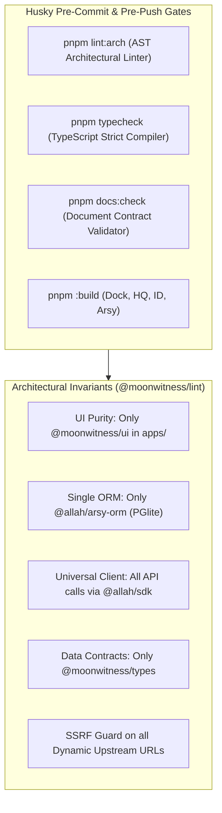

# SPEC: Strict Monorepo Architectural Linter, Typecheck & Document Correlation

## 1. Problem Statement & Architecture Goals
The MoonWitness / A-L-L-A-H.COM monorepo has grown rapidly with Fastify Hub, PGlite ORM, AI Gateway, Qorpus Memory, and multi-app frontends (`dock`, `headquarter`, `id`). To maintain long-term engineering hygiene, zero slop, and strict modularity, we must enforce **shared-aware architectural rules**:
1. **UI Layer Purity**: All interactive UI elements across `apps/` must import from `@moonwitness/ui`. Ad-hoc un-themed HTML elements (`<button>`, `<input>`) are strictly forbidden.
2. **Zero ORM Overlap**: PGlite via `@allah/arsy-orm` is the sole database engine. No secondary ORMs (`drizzle-orm`, `@prisma/client`, `typeorm`, `mongoose`).
3. **SDK Invariant**: Client-to-server communications must route through `@allah/sdk`. Hardcoded endpoints or ad-hoc fetch wrappers are blocked.
4. **Contract Invariant**: Shared entities and payload schemas must be imported from `@moonwitness/types`.
5. **Strict TypeScript Typing**: No implicit any, strict null checks, strict member initialization, and zero compilation warnings.
6. **Self-Healing Documentation Harmonization**: All canonical Markdown documentation (`AGENTS.md`, `QUALITY.md`, `DOCUMENTATION_CONTRACT.md`, `BLUEPRINT.md`, `BACKLOG.md`, `DESIGN.md`) must be fully synchronized and aware of architectural invariants.

---

## 2. Requirements & Deliverables

### 2.1 `@moonwitness/lint` AST Architectural Linter
- Implement an automated linter engine in `packages/lint/src/check-architecture.mjs` executable via `pnpm lint:arch`:
  - **Rule 1 (`ui-purity`)**: Scans all `apps/**/*.{tsx,jsx}` files. Blocks raw un-themed `<button` or `<input` elements unless imported or wrapped by `@moonwitness/ui`.
  - **Rule 2 (`single-orm`)**: Scans entire codebase for forbidden third-party ORMs (`drizzle-orm`, `@prisma/client`, `typeorm`, `mongoose`).
  - **Rule 3 (`sdk-client`)**: Scans `apps/` for ad-hoc un-typed calls to `/v1/` or `/api/` bypassing `@allah/sdk`.
  - **Rule 4 (`shared-types`)**: Scans for duplicated type declarations that belong in `@moonwitness/types`.
  - **Rule 5 (`ssrf-guard`)**: Verifies that any dynamic upstream fetch calls are protected by `validateUrlSsrf`.
- Configure `packages/lint/package.json` with CLI executable bin `bin/check-architecture.mjs`.

### 2.2 Strict TypeScript Configuration
- Add root `tsconfig.base.json` with strict compiler options:
  - `strict: true`
  - `noImplicitAny: true`
  - `strictNullChecks: true`
  - `forceConsistentCasingInFileNames: true`
- Add root script `"typecheck": "pnpm -r --parallel exec tsc --noEmit"` and `"lint:arch": "node packages/lint/src/check-architecture.mjs"`.

### 2.3 Husky Pre-Commit Gate Update
- Update `.husky/pre-commit` to run:
  1. `pnpm docs:check`
  2. `pnpm lint:arch`
  3. `pnpm typecheck`
- If any check fails, commit is immediately aborted.

### 2.4 Canonical Documentation Harmonization
- **`AGENTS.md`**: Add explicit section on `@moonwitness/lint`, architectural invariants, and mandatory shared package awareness.
- **`QUALITY.md`**: Remove legacy Rust Loco text and replace with Fastify 5.x + PGlite + Next.js 16 + strict type checking standards.
- **`DESIGN.md`**: Explicitly document `@moonwitness/ui` usage mandates and antislop compliance.
- **`BLUEPRINT.md`**: Update target architecture with AI Gateway, Qorpus, and unified SDK.
- **`DOCUMENTATION_CONTRACT.md`**: Confirm document correlation and change matrix.
- Ensure `pnpm docs:check` passes with 100/100 score.

---

## 3. Acceptance Criteria
1. `pnpm lint:arch` executes, scans all packages/apps, and passes with zero architectural violations.
2. `pnpm typecheck` compiles TypeScript across all workspace projects with zero type errors.
3. `.husky/pre-commit` enforces `pnpm docs:check`, `pnpm lint:arch`, and `pnpm typecheck`.
4. All canonical `.md` files are synchronized and pass `pnpm docs:check` with 100/100 score.
5. All 4 application production builds pass 100%.
