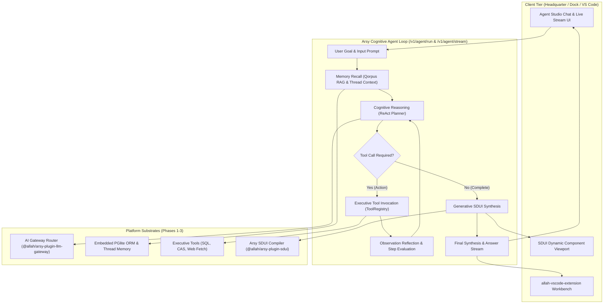

# SPEC: Phase 4 Autonomous Cognitive Agent Loop & Generative SDUI

## 1. Problem Statement & Architecture Goals
With Phase 1 (Multi-Provider AI Gateway & Fallback Router), Phase 2 (Cognitive Memory, Vector Semantic Cache, Qorpus RAG), and Phase 3 (Tool Registry, Normalized Tools, MCP Server) completed, A-L-L-A-H.COM now possesses the foundational substrates of an intelligent system:
1. **Sensory & Speech (Phase 1)**: Unified multi-model routing, SSE streaming, and virtual keys.
2. **Memory & Recall (Phase 2)**: Persistent vector semantic cache, embeddings, and Qorpus knowledge base.
3. **Hands & Executive Tools (Phase 3)**: Secure tool registry, safe SQL queries, CAS storage, SSRF-guarded web fetching, and MCP protocol endpoints.

**The Phase 4 Milestone**:
Phase 4 synthesizes these three substrates into an **Autonomous Cognitive Agent Operating Loop (AGI Engine)** and a **Generative Server-Driven UI (SDUI) Compiler**. The agent is no longer a passive single-turn completion endpoint; it reasons autonomously, retrieves memory, invokes tools iteratively across multiple turns, tracks its own cognitive trajectory, and dynamically streams server-driven UI layouts directly to the user interface.

---

## 2. Requirements & Deliverables

### 2.1 Autonomous ReAct Cognitive Agent Engine (`packages/arsy-plugin-llm-gateway`)
- **`AgentLoop` Runtime**:
  - Implements multi-turn ReAct reasoning loop:
    1. **Plan & Reason**: Model evaluates the goal and available tools.
    2. **Action**: Model emits structured tool call(s).
    3. **Execution**: Platform securely dispatches tool call through `toolRegistry.execute()`.
    4. **Observation**: Result is appended back to the conversation scratchpad.
    5. **Reflection**: Model inspects whether the objective has been reached or if additional iterations are required.
- **Safety Guardrails & Circuit Breaking**:
  - `max_steps` constraint (default: 8 iterations) to prevent infinite loops.
  - Step timeout guard (default: 30s per step).
  - Loop detection: terminates if identical tool arguments are executed three times consecutively without progress.
  - Fail-closed token and cost ceilings per agent session.
- **Endpoints**:
  - `POST /v1/agent/run`: Synchronous execution returning complete reasoning trace, executed tools, and final response.
  - `POST /v1/agent/stream`: Server-Sent Events (SSE) streaming real-time thoughts (`event: thought`), tool invocations (`event: tool_call`), tool results (`event: tool_result`), and final tokens (`event: message`).

### 2.2 Generative SDUI Synthesis Engine (`@allah/arsy-plugin-sdui`)
- Standardized tool `render_sdui`: Allows the cognitive agent to dynamically generate valid SDUI schema representations (`card`, `tree`, `table`, `form`, `stats-grid`, `kanban`).
- Validation against canonical `@moonwitness/types` SDUI view schema.
- Embedded rendering payload returned in agent response metadata for instant client hydration.

### 2.3 Universal Client SDK Extension (`@allah/sdk`)
- Add `agentRun(options)` and `agentStream(options, onEvent)` to `@allah/sdk`.
- Complete TypeScript typings for `AgentStep`, `AgentThought`, `AgentToolCallEvent`, and `AgentStreamEvent`.

### 2.4 Headquarter Agent Studio (`apps/headquarter/src/app/agent`)
- Interactive autonomous agent workspace built strictly with `@moonwitness/ui`:
  - Mission Goal input with selectable system prompts and max step sliders.
  - Live visual timeline showing chronological cognitive steps:
    - Thought badge (cyan/teal pulse).
    - Tool execution chip with collapsible argument/result viewer.
    - Live streamed Markdown response.
  - Dynamic SDUI Preview container rendering server-generated views.
  - Human-in-the-loop intervention and execution termination button.

### 2.5 Verification & Test Suite
- Comprehensive automated test `apps/arsy/test/agent_loop.test.mjs`:
  - Multi-step arithmetic / knowledge retrieval tool chaining test.
  - Loop detection & max steps termination test.
  - SSE agent event stream validation.

---

## 3. Acceptance Criteria
1. `POST /v1/agent/run` and `POST /v1/agent/stream` execute multi-step tool reasoning chains without human intervention.
2. The agent automatically selects and executes tools (`pglite_query`, `storage_cas`, `web_fetch`, `qorpus_retrieve`, `render_sdui`) based on prompt context.
3. Safety limits (`max_steps`, loop detection) reliably prevent runaway execution.
4. `@allah/sdk` provides typed `agentRun` and `agentStream` methods.
5. Headquarter `/agent` dashboard provides a clean, reactive monitoring and execution interface built exclusively with `@moonwitness/ui`.
6. Monorepo Quality Gates pass 100%:
   - `pnpm docs:check` (100/100 pts)
   - `pnpm lint:arch` (100% compliant)
   - `pnpm typecheck` (0 errors)
   - All 4 builds succeed (`dock:build`, `headquarter:build`, `id:build`, `@allah/arsy build`).

