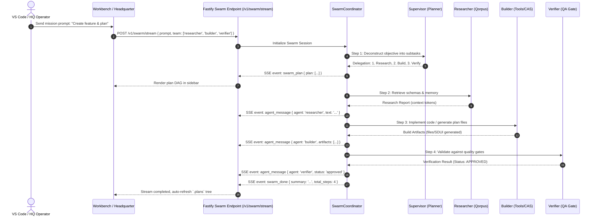

# Design: Autonomous IDE Agent Workbench & Multi-Agent Swarm Orchestration

## 1. Multi-Agent Swarm Interaction Sequence



---

## 2. API Contract Specifications

### 2.1 Request Schema (`POST /v1/swarm/run` & `/v1/swarm/stream`)
```typescript
interface SwarmRunRequest {
  mission: string;
  system_context?: string;
  agents?: Array<'planner' | 'researcher' | 'builder' | 'verifier'>;
  max_turns?: number;        // default: 12
  consensus_required?: boolean; // default: true (verifier must approve)
}
```

### 2.2 SSE Swarm Stream Protocol (`/v1/swarm/stream`)
Standardized server-sent events:
- `event: swarm_init`: Emitted when swarm session initializes.
  ```json
  { "session_id": "swm_123", "agents": ["planner", "researcher", "builder", "verifier"] }
  ```
- `event: agent_handoff`: Emitted when control transfers to another agent.
  ```json
  { "from": "planner", "to": "researcher", "reason": "Query codebase schemas" }
  ```
- `event: agent_thought`: Emitted as active agent reasons.
  ```json
  { "agent": "researcher", "thought": "Querying Qorpus for authentication models..." }
  ```
- `event: agent_action`: Emitted when an agent triggers a tool.
  ```json
  { "agent": "builder", "tool": "storage_cas", "args": { "action": "put", "content": "..." } }
  ```
- `event: agent_result`: Emitted with tool execution result.
  ```json
  { "agent": "builder", "success": true, "result": { "hash": "e3b0c44..." } }
  ```
- `event: verification`: Emitted when verifier signs off or requests revision.
  ```json
  { "approved": true, "checks_passed": ["lint", "typecheck", "docs"] }
  ```
- `event: swarm_done`: Emitted upon mission completion.
  ```json
  { "success": true, "total_turns": 4, "summary": "All deliverables verified" }
  ```

---

## 3. UI Design Specifications

### 3.1 Headquarter Swarm Dashboard (`/swarm`)
- Built exclusively with `@moonwitness/ui`:
  - `Card`, `Badge`, `Button`, `Input`, `EcosystemNavbar`.
- Agent role color coding:
  - Supervisor: Purple (`#a855f7`)
  - Researcher: Cyan (`#06b6d4`)
  - Builder: Amber (`#f59e0b`)
  - Verifier: Emerald (`#10b981`)
- Live activity feed with avatar badges and step timing.

### 3.2 VS Code Extension Agent Workbench
- Dark theme native to VS Code CSS variables (`var(--vscode-editor-background)`, etc.).
- Direct integration with workspace file system via VS Code API (`vscode.workspace.fs`).
- Embedded one-click button: **"Apply Plan to Workspace"**.

