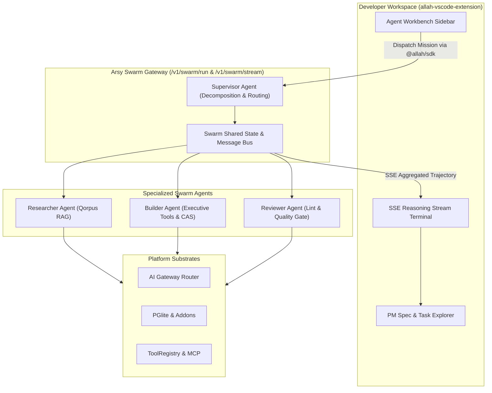

# SPEC: Autonomous IDE Agent Workbench & Multi-Agent Swarm Orchestration

## 1. Problem Statement & Architecture Goals
Following the completion of **Phase 1-4 AGI Foundations** (Multi-Provider AI Gateway, Semantic Memory Qorpus, Executive Tool Registry & MCP, and ReAct Cognitive Agent Loop), the platform must extend in two crucial operational dimensions:

1. **Dimension 2: VS Code Extension Autonomous Agent Workbench (`allah-vscode-extension`)**:
   - Currently, the VS Code extension provides a static tree view and plan file viewer.
   - Developers need an active, autonomous **Agent Workbench** inside the IDE sidebar:
     - Directly streaming cognitive reasoning steps (`thought`, `tool_call`, `observation`, `sdui`) using `@allah/sdk`.
     - Autonomous generation and self-healing of `.plans/<timestamp>-<slug>/` (`spec.md`, `task.md`, `design.md`, `rules.md`, `report.md`).
     - One-click trigger to execute tasks with automatic file edits, lint checks, and typechecks directly in the workspace.

2. **Dimension 3: Multi-Agent Swarm Orchestration (`@allah/arsy-plugin-llm-gateway`)**:
   - Complex engineering missions cannot be resolved by a single monolithic agent without context saturation or hallucination.
   - The platform requires a **Hierarchical Multi-Agent Swarm**:
     - **Supervisor Agent (Planner & Dispatcher)**: Deconstructs large goals into specialized subtasks.
     - **Researcher Agent (Memory & Retrieval)**: Queries Qorpus RAG and code schemas.
     - **Coder / Builder Agent (Execution & Action)**: Executes tools, generates files, and manages CAS storage.
     - **Reviewer / QA Agent (Verification & Quality Gate)**: Verifies documentation contracts, architectural invariants, and strict typechecks before signing off.
     - Inter-agent message passing and state aggregation via Fastify Hub.

---

## 2. Requirements & Deliverables

### 2.1 Multi-Agent Swarm Engine (`packages/arsy-plugin-llm-gateway/src/swarm`)
- **Swarm Orchestrator (`SwarmCoordinator`)**:
  - Manages multi-agent lifecycle, delegation protocols, and context partition.
  - Implements consensus / sign-off verification before mission completion.
- **Specialized Agent Roles**:
  - `planner`: Formulates execution DAG and milestones.
  - `researcher`: Retrieves contextual schema, API contracts, and prior memories.
  - `builder`: Executes tools, generates code, renders SDUI components.
  - `verifier`: Evaluates outcome against acceptance criteria.
- **Swarm Communication Protocol**:
  - Inter-agent typed message envelope: `{ from, to, role, payload, timestamp }`.
  - Aggregated SSE stream: `event: swarm_agent_step` tagging each action with the active agent role and icon.
- **Endpoints**:
  - `POST /v1/swarm/run`: Synchronous multi-agent execution payload.
  - `POST /v1/swarm/stream`: Multi-agent parallel/hierarchical SSE stream.

### 2.2 VS Code Extension Autonomous Agent Workbench (`allah-vscode-extension`)
- **Interactive Webview Sidebar**:
  - Live chat and goal prompt input.
  - Role-badged cognitive trajectory timeline (Supervisor $\rightarrow$ Researcher $\rightarrow$ Builder $\rightarrow$ Reviewer).
  - Integrated `.plans` synchronization: one-click to generate canonical plan artifacts directly in the active project.
  - Real-time task checkbox updates in the VS Code PM tree view.
- **Client Integration**:
  - Connects to local Arsy Fastify Hub (`http://localhost:5150`) or remote hub via `@allah/sdk`.

### 2.3 Universal Client SDK Extension (`packages/sdk`)
- Add `mwClient.swarm.run(options)` and `mwClient.swarm.stream(options, onEvent)`.
- Typed interfaces for `SwarmAgentMessage`, `SwarmStep`, and `SwarmExecutionResult`.

### 2.4 Headquarter Swarm Operations Dashboard (`apps/headquarter/src/app/swarm`)
- Visual multi-agent swarm monitor built exclusively with `@moonwitness/ui`:
  - Active agents status cards (Supervisor, Researcher, Builder, Reviewer).
  - Live inter-agent message timeline.
  - Task delegation DAG visualization.

---

## 3. Acceptance Criteria
1. `POST /v1/swarm/run` and `/v1/swarm/stream` successfully orchestrate multiple specialized agents to achieve complex tasks.
2. Inter-agent handoffs maintain tenant boundary and token budgets.
3. `@allah/sdk` provides typed `mwClient.swarm` methods.
4. `allah-vscode-extension` compiles and interacts with the Arsy Hub streaming endpoints.
5. Headquarter `/swarm` page provides complete operational visibility.
6. All monorepo quality gates pass 100%:
   - `pnpm docs:check` (100/100 pts)
   - `pnpm lint:arch` (100% compliant)
   - `pnpm typecheck` (0 errors)
   - All 4 builds succeed (`dock`, `headquarter`, `id`, `arsy`).

