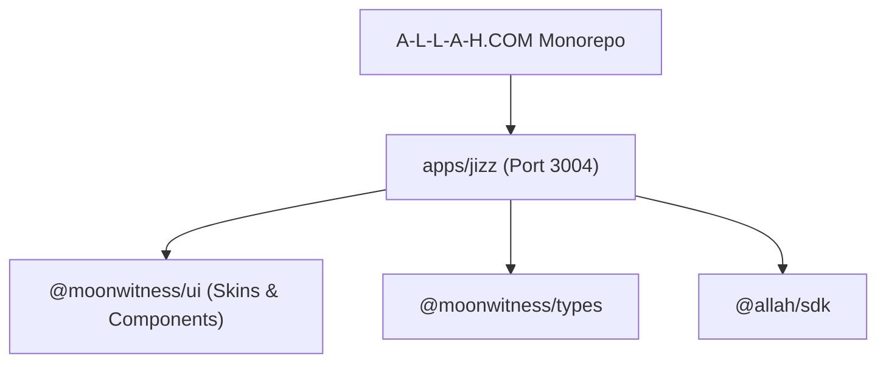

# SPEC: JIZZ Phase 1 — Foundation & Next.js 16 Application Scaffolding

## 1. Context & Architecture Goal
- **App Directory**: `apps/jizz/` (Dedicated Next.js 16 App Router application for World Observatory & Perspective Intelligence, powered by ROCKSOUL JIZZ).
- **Design Skin**: Leverages existing `@moonwitness/ui` skins (`packages/ui/src/skins`), leaving skin development to the UI team.
- **Port Target**: `3004` (Dock: 3001, Headquarter: 3002, ID: 3003, JIZZ: 3004).
- **Phase Scope**: Set up `apps/jizz/package.json`, `tsconfig.json`, `next.config.ts`, Tailwind v4 styling, root layout with skin wrapper, and root workspace scripts (`pnpm jizz:dev`, `pnpm jizz:build`).

## 2. Requirements & Deliverables
1. Initialize `apps/jizz` with Next.js 16 App Router, React 19, strict TypeScript, and Tailwind CSS v4.
2. Configure pnpm workspace linkage with `@moonwitness/ui`, `@moonwitness/types`, and `@allah/sdk`.
3. Add root layout embedding `MoonFrameRoot` from `@moonwitness/ui/skins`.
4. Add root `package.json` scripts: `"jizz:dev": "pnpm --filter @moonwitness/jizz dev"`, `"jizz:build": "pnpm --filter @moonwitness/jizz build"`.
5. Ensure `pnpm lint:arch` and `pnpm typecheck` pass.

## 3. Acceptance Criteria
1. `apps/jizz` compiles with zero errors via `pnpm jizz:build`.
2. UI purity is strictly maintained via `@moonwitness/ui`.
3. No raw un-themed HTML elements.

