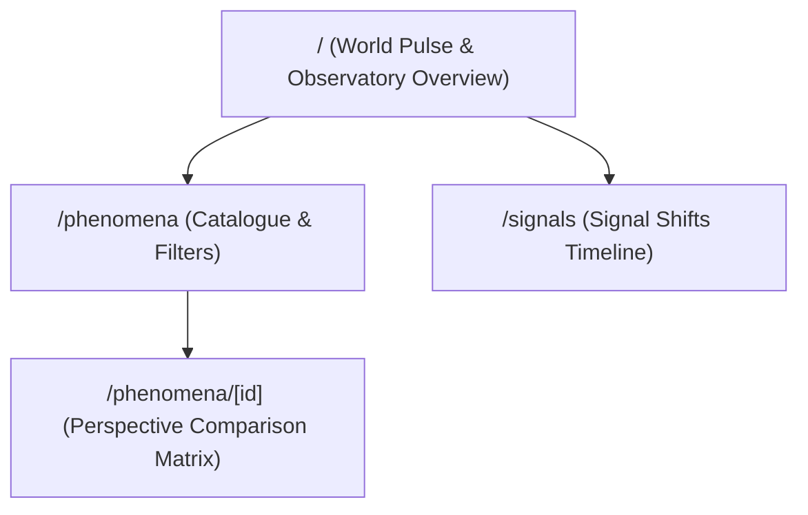

# SPEC: JIZZ Phase 3 — Core Observatory & Perspective Screens

## 1. Context & Architecture Goal
- Build the core user experience for `apps/jizz`:
  1. **World Pulse / Home Overview (`/`)**: High-level observatory metrics, world phenomena feed, perspective divergence signals.
  2. **Phenomena Catalogue (`/phenomena`)**: Filterable, searchable directory of public events and phenomena.
  3. **Phenomenon Detail & Perspective Matrix (`/phenomena/[id]`)**: Deep multi-perspective comparison matrix (How different actors/regions frame the same event).
  4. **Signals & Changes Timeline (`/signals`)**: Real-time signal shifts over time.

## 2. Requirements & Deliverables
1. Build pages strictly importing from `@moonwitness/ui`.
2. Support active skin switching via `MoonFrameRoot` (using Lunar Chronicles by default).
3. Provide accessible empty, loading, and error states.
4. Fully responsive on mobile, tablet, and desktop viewports.

## 3. Acceptance Criteria
1. All routes compile and render cleanly with Next.js Turbopack.
2. Zero architectural lint errors (`pnpm lint:arch`).
3. High contrast and keyboard navigable interactions.

