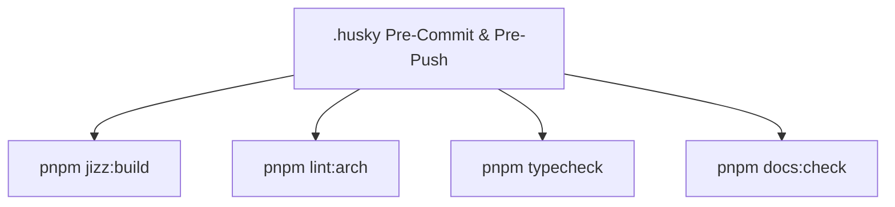

# SPEC: JIZZ Phase 4 — Integration, Verification & Quality Gates

## 1. Context & Architecture Goal
- Complete monorepo integration for `apps/jizz`:
  1. Add pre-commit and pre-push validation gates for JIZZ.
  2. Add unit and integration smoke tests.
  3. Ensure `pnpm docs:check`, `pnpm lint:arch`, `pnpm typecheck`, and production builds succeed 100%.

## 2. Requirements & Deliverables
1. Update `.husky/pre-push` to include `pnpm jizz:build`.
2. Update root `package.json` `"typecheck"` to cover `apps/jizz/tsconfig.json`.
3. Create end-to-end route smoke tests in `apps/jizz/test/smoke.test.mjs`.
4. Synchronize all canonical documentation (`CHANGELOG.md`, `BACKLOG.md`, `QUALITY.md`, `BLUEPRINT.md`).

## 3. Acceptance Criteria
1. All quality gates pass 100%.
2. Documentation score is 100/100.

