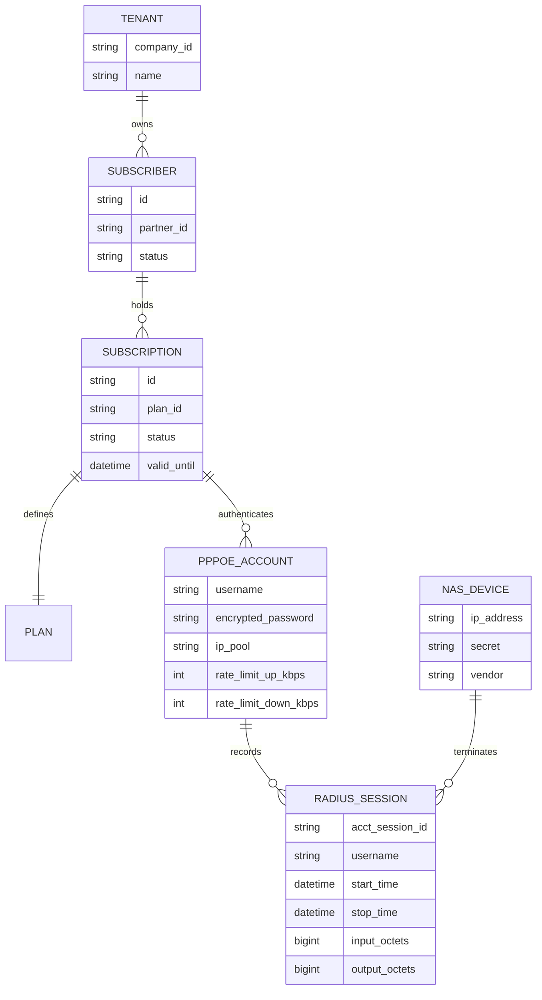

# Design: Network Foundation Phase 0 — Audit Current Repository & Reconcile Architecture (Issue #6)

## 1. Domain Ownership & Boundary Model

---

## 2. Invariant Guidelines
- **Single Authority**: ARSY Fastify Hub remains the sole HTTP backend and PGlite database authority.
- **Native UDP Runtime**: SENTINEL RADIUS runs as a dedicated Node.js process with `dgram` UDP sockets, querying ARSY ORM / PGlite directly or through Fastify internal control APIs.
- **No FreeRADIUS**: Zero FreeRADIUS binaries, libraries, or sidecars.

