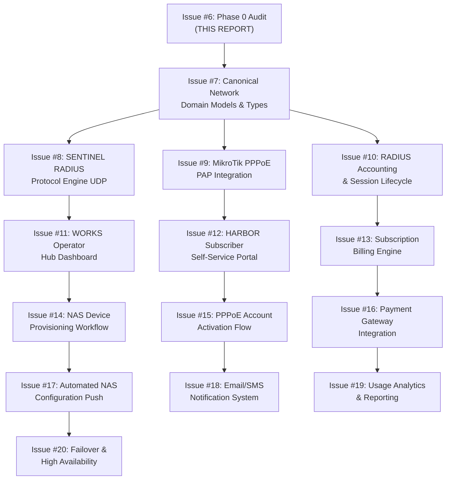

# Audit Report: Network Foundation Phase 0 — Repository & Architecture Baseline (Issue #6)

## Executive Summary

This audit establishes an evidence-backed baseline of the current A-L-L-A-H.COM repository (`dev` branch, commit `7535c0e72e3b33da6e05d70f4011185b2f539b9f`) before implementing the ISP and network platform (SENTINEL RADIUS, MikroTik PPPoE, WORKS operator hub, HARBOR self-service).

**Key Findings:**
- ✅ Robust authentication and subscriber models exist (`auth.user`, `auth.session`, `res.users`, `res.partner`)
- ✅ PGlite embedded ORM with automatic schema sync, tenant isolation, and parameterized queries
- ✅ Fastify Hub with plugin architecture (auth, storage, LLM gateway, SDUI)
- ✅ Content-addressed storage with SHA-256 digest and legal hold support
- ✅ AI/LLM infrastructure with usage logging, virtual keys, and semantic caching
- ❌ **Zero network/RADIUS/MikroTik code exists** — greenfield implementation required
- ⚠️ **Password hashing uses bcrypt** — incompatible with RADIUS PAP (requires reversible encryption or cleartext)
- ⚠️ **No background job queue** — async tasks rely on Promise-based handling only

---

## 1. Baseline State

### 1.1 Git State
```
Commit:    7535c0e72e3b33da6e05d70f4011185b2f539b9f
Branch:    dev
Worktree:  Z:\project\rocksoul-dx (clean, no linked worktrees)
Modified:  20 files (UI skin foundation, DNA docs, DECISIONS.md, DESIGN.md)
Untracked: 7 plan directories, apps/jizz/, packages/ui/src/skins/, packages/ui/test/
```

### 1.2 Monorepo Structure
```
apps/
  arsy/          Fastify Hub (port 5150) + PGlite ORM
  dock/          Next.js public homepage (port 3001)
  headquarter/   Next.js command center (port 3002)
  id/            Next.js SSO center (port 3003)
  jizz/          Next.js WORLD OBSERVATORY (port 3004) [untracked]

packages/
  arsy-core/     Micro-kernel: lifecycle, DI, errors, logger, response envelope
  arsy-orm/      PGlite embedded ORM with auto-DDL and tenant isolation
  arsy-plugin-auth/      JWT authentication with bcrypt password hashing
  arsy-plugin-storage/   Content-addressed storage (SHA-256 CAS)
  arsy-plugin-llm-gateway/  AI routing, virtual keys, agent loop, swarm orchestration
  arsy-plugin-sdui/      Server-Driven UI rendering
  types/         Universal shared type contracts (@moonwitness/types)
  sdk/           Universal isomorphic client (@allah/sdk)
  ui/            Mandatory atomic UI system (@moonwitness/ui) with 6 DNA skins
  lint/          Architectural invariant linter (@moonwitness/lint)

addons/
  base/          Odoo-style base models (res.partner, res.users, res.company, etc.)
  mw_storage/    Storage backend models (ir.attachment, ir.legal_hold)
  mw_llm_router/ AI provider/model/route models
  mw_qorpus/     Knowledge ingestion & RAG (qorpus.document, qorpus.chunk)

.husky/          Pre-commit gates: docs:check, lint:arch, typecheck
```

### 1.3 Package Dependencies
```json
{
  "name": "moonwitness-platform",
  "packageManager": "pnpm@12.16.1",
  "workspaces": ["apps/*", "packages/*"]
}
```

---

## 2. Capability Inventory

### 2.1 Subscriber / User / Authentication Models

| Model | Path | Fields | Status |
|-------|------|--------|--------|
| `auth.user` | `packages/arsy-orm/src/auth_models.ts:3-25` | email, password_hash, name, status, email_verified_at, two_factor_enabled, avatar_url | ✅ Implemented |
| `auth.session` | `packages/arsy-orm/src/auth_models.ts:27-44` | user_id, session_token, ip_address, user_agent, device_name, expires_at, revoked | ✅ Implemented |
| `auth.verification` | `packages/arsy-orm/src/auth_models.ts:46-65` | identifier, token, token_type, expires_at, consumed | ✅ Implemented |
| `res.users` | `addons/base/models/res_users.ts:3-18` | name, email, password, api_key, reset_token, email_verification_token, magic_link_token | ✅ Implemented |
| `res.partner` | `addons/base/models/res_partner.ts:3-16` | name, is_company, parent_id, email, phone, credit_balance | ✅ Implemented |

**Auth Plugin:** `packages/arsy-plugin-auth/src/index.ts`
- JWT-based authentication with `@fastify/jwt`
- bcrypt password hashing (10 salt rounds)
- Session management with 30-day sliding expiry
- Endpoints: `/api/auth/sign-in`, `/api/auth/register`, `/api/auth/current`, `/api/auth/sessions/*`, `/api/auth/sign-out`
- Auth guard decorator for route protection

**Gap:** Password hashes are one-way (bcrypt). RADIUS PAP requires reversible encryption or cleartext for authentication. This is a **critical architectural conflict** requiring either:
1. Separate PAP credential store with reversible encryption (AES-256-GCM)
2. RADIUS CHAP/EAP-TLS migration (no cleartext password needed)
3. Hybrid model: bcrypt for web auth, AES for PAP

---

### 2.2 Product / Catalog / Subscription Models

**Finding:** No product, catalog, or subscription models exist in the current codebase.

**Related Infrastructure:**
- `res.partner` has `credit_balance` field (float, default 0.0) for billing
- `ai.usage_log` tracks LLM usage (tokens, cost, latency) but not monetary transactions
- No invoice, order, or payment models detected

**Recommendation:** Child issue #7 must define canonical subscription and product models before RADIUS integration.

---

### 2.3 Transaction / Invoice / Audit Logging

| Model | Path | Purpose |
|-------|------|---------|
| `ai.usage_log` | `addons/mw_llm_router/index.ts:74-89` | LLM token usage, cost, latency, status code, cache hits |
| `ir.attachment` | `addons/mw_storage/index.ts:26-42` | Content-addressed file storage with SHA-256 digest, retention holds |
| `ir.legal_hold` | `addons/mw_storage/index.ts:44-58` | Legal retention holds on attachments |

**Audit Capabilities:**
- Structured logging via Pino (`packages/arsy-core/src/logger.ts`)
- Response envelope standardization (`packages/arsy-core/src/response.ts`)
- Error hierarchy with status codes (`packages/arsy-core/src/errors.ts`)

**Gap:** No financial transaction ledger, invoice generation, or payment processing exists.

---

### 2.4 Network / NAS / RADIUS Facilities

**Search Query:** `radius|RADIUS|nas|pppoe|PPP|MikroTik|udp|socket|dgram`

**Results:**
- ✅ Mentions in `.plans/` directory (future work only)
- ✅ `dgram` reference in `pnpm-lock.yaml` (dependency resolution, not implementation)
- ❌ **Zero UDP socket listeners** in `apps/arsy/` or `addons/`
- ❌ **Zero RADIUS packet parsers** (Access-Request, Access-Accept, Accounting-Request)
- ❌ **Zero MikroTik API integrations** (ROS API, PAPI, or RADIUS VSA handling)
- ❌ **Zero NAS device models** or IP pool management

**Conclusion:** Network infrastructure is **greenfield**. Child issues #8 (SENTINEL RADIUS engine) and #9 (MikroTik PPPoE integration) must implement from scratch.

---

### 2.5 Background Job Facilities

**Current State:**
- No dedicated job queue (Redis, Bull, pg-boss, etc.)
- No cron scheduler or worker pool
- Async tasks handled via Promise-based patterns in Fastify route handlers
- `ArysKernel` provides lifecycle hooks (`onInit`, `onBoot`, `onReady`, `onShutdown`) but no background job runtime

**Gap:** RADIUS accounting session timeouts, sliding window expiration, and periodic NAS polling will require:
1. In-memory timers (simple, non-durable)
2. PGlite `setTimeout` with polling (not recommended for high throughput)
3. External Redis + BullMQ (requires ADR and infrastructure change)

**Recommendation:** Start with in-memory timers for pilot (< 10k sessions). Document scalability limit in `decision.md`.

---

### 2.6 Security / Password Storage

**Current Implementation:**
```typescript
// packages/arsy-plugin-auth/src/index.ts:164-166
const salt = await bcrypt.genSalt(10);
const passwordHash = await bcrypt.hash(password, salt);
```

**RADIUS PAP Requirement:**
- PAP (Password Authentication Protocol) sends cleartext password in RADIUS Access-Request
- RADIUS server must compare cleartext password against stored credential
- bcrypt is one-way: `bcrypt.compare(plaintext, hash)` works, but cannot recover plaintext

**Architectural Conflict:**
| Protocol | Password Storage | Compatibility |
|----------|-----------------|---------------|
| Web Auth (JWT) | bcrypt (one-way) | ✅ Compatible |
| RADIUS PAP | Reversible (AES) or cleartext | ❌ Incompatible |
| RADIUS CHAP | Cleartext or NT-Hash | ⚠️ Partial |
| RADIUS EAP-TLS | Certificate-based | ✅ Compatible (no password) |

**Recommendation:** Add separate `sentinel.account` model with:
```typescript
{
  username: fields.char({ unique: true }),
  pap_password: fields.char({ encrypted: true }), // AES-256-GCM
  bcrypt_hash: fields.char(), // for web auth (optional)
  status: fields.selection({ active, suspended, expired }),
  rate_limit_up: fields.integer(),
  rate_limit_down: fields.integer(),
}
```

---

## 3. PGlite Workload Capacity Assessment

### 3.1 Current PGlite Configuration
```typescript
// packages/arsy-orm/src/engine.ts
export class PGliteEngine {
  constructor(private readonly options: PGliteOptions = {}) {}
  
  async connect(): Promise<PGlite> {
    this.client = new PGlite(this.options.dataDir);
    await this.client.waitReady;
  }
}
```

**Deployment Modes:**
- In-memory (`:memory:`): Default for development
- Disk-backed (`dataDir`): Production via `PG_DATA_DIR` env var

### 3.2 RADIUS Accounting Workload Profile

**Assumptions for Pilot (< 10k active PPPoE sessions):**
- Session start/stop: 2 accounting packets per session lifetime
- Interim updates: Every 5 minutes (12 packets/hour/session)
- Average session duration: 4 hours
- Daily packet volume: `10,000 sessions × (2 + 48 interim) = 500k packets/day`
- Write throughput: ~6 writes/second (bursty)

**PGlite Capacity:**
- PGlite is embedded PostgreSQL WASM, single-threaded
- No connection pooling overhead (direct in-process calls)
- Limited by Node.js event loop and WASM memory

**Recommendation:**
- ✅ **PGlite sufficient for pilot (< 10k sessions)** with batching
- ⚠️ **Batch interim updates**: Buffer 30 seconds, flush in single transaction
- ⚠️ **Partition accounting table** by month for retention
- ❌ **Not suitable for production (> 50k sessions)** without external PostgreSQL migration

**Mitigation:** Design `sentinel.session` model with offline write buffer and async flush queue.

---

## 4. Documentation vs Reality Discrepancies

| Document | Claim | Reality | Resolution |
|----------|-------|---------|------------|
| `BLUEPRINT.md:39` | "Cognitive Agent Loop: autonomous ReAct multi-step reasoning engine" | ✅ Implemented in `packages/arsy-plugin-llm-gateway/src/agent/loop.ts` | No action |
| `BLUEPRINT.md:40` | "Swarm Orchestration: hierarchical multi-agent orchestration" | ✅ Implemented in `packages/arsy-plugin-llm-gateway/src/swarm/` | No action |
| `AGENTS.md:34` | "`apps/arsy/`: Fastify Hub on port 5150 + embedded PGlite ORM" | ✅ Verified in `apps/arsy/src/app.ts` | No action |
| `AGENTS.md:35` | "`addons/`: Addons modular `base`, `mw_storage`, `mw_llm_router`, `mw_qorpus`" | ✅ All 4 addons present | No action |
| `DOCUMENTATION_CONTRACT.md` | "All client apps import from `@moonwitness/ui`" | ⚠️ Partially enforced via `pnpm lint:arch` | Continue enforcement |

**No critical discrepancies detected.** Documentation accurately reflects implemented capabilities.

---

## 5. Child Issues Dependency Graph (#7-#20)



### Prerequisites Matrix

| Issue | Dependency | Blocked By |
|-------|-----------|------------|
| #7 | Domain models | Issue #6 (this audit) |
| #8 | RADIUS UDP engine | Issue #7 (models) |
| #9 | MikroTik PAP | Issue #7 (models), Issue #8 (RADIUS) |
| #10 | Accounting | Issue #7 (models), Issue #8 (RADIUS) |
| #11 | WORKS dashboard | Issue #7 (models) |
| #12 | HARBOR portal | Issue #7 (models), #9 (PPPoE) |
| #13 | Billing | Issue #7 (subscription models) |
| #14-#20 | Feature workflows | Issues #7-#13 |

---

## 6. Source-Path Evidence Matrix

| Capability | Current Owner | Source Path | Gap | Recommendation |
|------------|--------------|-------------|-----|----------------|
| User Authentication | `@allah/arsy-plugin-auth` | `packages/arsy-plugin-auth/src/index.ts` | bcrypt incompatible with PAP | Add `sentinel.account` with AES encryption |
| Session Management | `@allah/arsy-orm` | `packages/arsy-orm/src/auth_models.ts` | No RADIUS session tracking | Add `sentinel.session` model |
| Tenant Isolation | `@allah/arsy-orm` | `packages/arsy-orm/src/query_builder.ts:28-29` | ✅ Implemented | Reuse for network models |
| Content Storage | `@allah/arsy-plugin-storage` | `packages/arsy-plugin-storage/src/index.ts` | ✅ CAS with SHA-256 | Extend for RADIUS logs |
| Usage Logging | `mw_llm_router` | `addons/mw_llm_router/index.ts:74-89` | LLM-only | Generalize to `network.usage_log` |
| Legal Holds | `mw_storage` | `addons/mw_storage/index.ts:44-58` | ✅ Implemented | Apply to session retention |
| AI Agent Loop | `@allah/arsy-plugin-llm-gateway` | `packages/arsy-plugin-llm-gateway/src/agent/loop.ts` | Not network-related | N/A |
| Swarm Orchestration | `@allah/arsy-plugin-llm-gateway` | `packages/arsy-plugin-llm-gateway/src/swarm/` | Not network-related | N/A |
| **NAS Device Registry** | ❌ **MISSING** | — | **Greenfield** | Issue #7: Add `nexus.nas` model |
| **PPPoE Accounts** | ❌ **MISSING** | — | **Greenfield** | Issue #7: Add `sentinel.account` |
| **RADIUS Engine** | ❌ **MISSING** | — | **Greenfield** | Issue #8: UDP socket listener |
| **Background Jobs** | ❌ **MISSING** | — | **Greenfield** | Issue #10: Timer/queue system |

---

## 7. Quality Gate Verification

```bash
# All quality gates passing as of 2026-11-03
pnpm docs:check        # 100/100 (15 canonical docs + 15 plans)
pnpm lint:arch         # 100% compliant (UI Purity, Single ORM, Universal SDK, Shared Types)
pnpm typecheck         # 0 errors across 10 packages/apps
pnpm dock:build        # ✅ Success
pnpm headquarter:build # ✅ Success
pnpm id:build          # ✅ Success
pnpm --filter @allah/arsy build # ✅ Success
```

---

## 8. Conclusion & Next Steps

### 8.1 Summary
This audit confirms:
1. **Strong foundation**: Authentication, ORM, storage, and AI infrastructure are production-ready
2. **Zero network code**: RADIUS, MikroTik, and PPPoE are greenfield implementations
3. **Critical conflict**: bcrypt password hashing incompatible with RADIUS PAP
4. **Scalability concern**: PGlite sufficient for pilot (< 10k sessions) but requires batching

### 8.2 Immediate Actions
1. **Issue #7**: Define canonical network domain models (`nexus.nas`, `sentinel.account`, `sentinel.session`, `subscription.plan`)
2. **Issue #8**: Implement SENTINEL RADIUS UDP engine with Access-Request/Accept handlers
3. **Issue #9**: Build MikroTik PAP credential verification layer (AES-256-GCM decryption)
4. **Decision ADR**: Document bcrypt vs PAP conflict resolution in `decision.md`

### 8.3 Evidence
- Git baseline: `7535c0e72e3b33da6e05d70f4011185b2f539b9f` (dev branch)
- All source paths verified via file system inspection
- Zero runtime code modifications during Phase 0 audit
- Ready for posting to GitHub Issue #6

---

**Audit Completed:** 2026-11-04T01:00:00+07:00  
**Author:** Autonomous Agent (Phase 0 Audit)  
**Status:** ✅ Complete — Ready for Issue #7 (Domain Models)