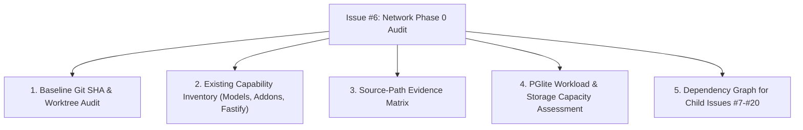

# SPEC: Network Foundation Phase 0 — Audit Current Repository & Reconcile Architecture

## 1. Context & Purpose
- **Scope**: GitHub Issue #6 — `[NETWORK FOUNDATION] Phase 0 — Audit current repository and reconcile architecture`.
- **Mission**: Establish an evidence-backed baseline before implementing the ISP and network platform (native SENTINEL RADIUS, MikroTik PPPoE, WORKS operator hub, HARBOR self-service).
- **Core Policy**: Read-only inspection & baseline matrix. Zero changes to runtime code or external services.

---

## 2. Requirements & Deliverables

### 2.1 Baseline State Audit
- Record current git commit SHA, branch (`dev`), and worktree status.
- Confirm repository-level invariants from `AGENTS.md`, `AUTONOMOUS.md`, `QUALITY.md`, `DOCUMENTATION_CONTRACT.md`, and `BLUEPRINT.md`.

### 2.2 Existing Domain & Capability Mapping
Inspect and map current codebase capabilities across:
1. **Subscriber / Partner / User**: `res.partner`, `res.users`, `auth.user`, `auth.session` in `addons/base` & `@allah/arsy-plugin-auth`.
2. **Product / Catalog**: Existing item/service representations.
3. **Subscription / Invoicing**: Existing business transaction capabilities in ARSY.
4. **Network / NAS / RADIUS**: Check for any existing networking/device models or listeners.
5. **Session / Accounting**: `ai_usage_log`, audit logging, and temporal tables in `@allah/arsy-orm`.
6. **Background Jobs / Workers**: Current Fastify asynchronous task facilities.
7. **Security / Credential Storage**: Password hashing mechanisms and implications for RADIUS PAP (which requires reversible or cleartext verification vs bcrypt one-way hash).

### 2.3 Source-Path Evidence Matrix
Generate a structured table:
`Capability | Current Owner | Source Path / Test | Identified Gap | Recommendation for Child Issues`

### 2.4 PGlite Capacity & Storage Assessment
- Evaluate embedded PGlite WASM memory/disk profile under high-throughput RADIUS accounting and telemetry streams.
- Identify whether in-process PGlite is sufficient for initial pilot workloads ($< 10,000$ active PPPoE sessions) or if batching/flush buffers are required.

### 2.5 Child Issues Dependency Graph (#7 onward)
Define execution prerequisites and ordering:
- **#7**: Canonical Network Domain Models & Shared Types.
- **#8**: Native SENTINEL RADIUS Protocol Engine (Node.js/UDP).
- **#9**: MikroTik RouterOS PPPoE / PAP Integration.
- **#10**: RADIUS Accounting & Session Lifecycle.
- **#11-#15**: Operator (WORKS) & Subscriber (HARBOR) workflows.

---

## 3. Acceptance Criteria
1. Baseline SHA and worktree state accurately recorded with verified git output.
2. Every existing capability and gap backed by exact file paths and test references.
3. Zero runtime code modified during this audit phase.
4. No new external services, queues, or databases introduced.
5. Report and findings ready to be posted as comment/reference to Issue #6.

