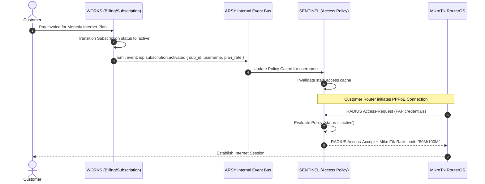

# Design: ISP Product Phase 1 — Canonical Domain Models & Cross-Domain Contracts (Issue #7)

## 1. Domain Event & Communication Flow



---

## 2. API Contract Specifications

### 2.1 Access Decision Interface
```typescript
export interface SentinelAccessDecision {
  allowed: boolean;
  reply_code: 'Access-Accept' | 'Access-Reject';
  reject_reason?: string;
  framed_ip_address?: string;
  mikrotik_rate_limit?: string; // e.g. "20M/50M 0/0 0/0 0/0 8"
  session_timeout_seconds?: number;
}
```

### 2.2 Accounting Event Interface
```typescript
export interface SentinelAccountingEvent {
  acct_status_type: 'Start' | 'Stop' | 'Interim-Update';
  acct_session_id: string;
  username: string;
  nas_ip_address: string;
  framed_ip_address?: string;
  input_octets: number;
  output_octets: number;
  session_time_seconds: number;
  terminate_cause?: string;
}
```

