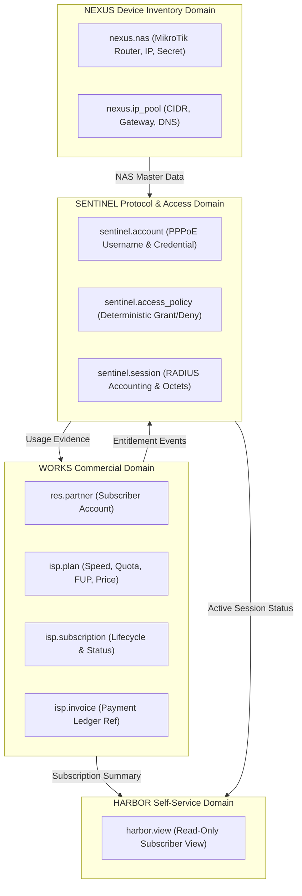

# SPEC: ISP Product Phase 1 — Canonical Domain Models & Cross-Domain Contracts

## 1. Context & Purpose
- **Scope**: GitHub Issue #7 — `[ISP PRODUCT] Define canonical ISP domain model and cross-domain contracts`.
- **Purpose**: Finalize the business and technical contract for a MikroTik-first ISP subscription platform before feature implementation.
- **Parent Master Issue**: GitHub Issue #5 (Master Plan Network, ISP & Product Ecosystem).

---

## 2. Requirements & Deliverables

### 2.1 Domain Ownership Invariants
1. **WORKS** owns:
   - Commercial plans (`isp.plan`): download/upload speed limits, bursting, FUP thresholds, pricing, validity duration.
   - Subscription lifecycle (`isp.subscription`): `draft` $\rightarrow$ `pending_payment` $\rightarrow$ `active` $\rightarrow$ `grace` $\rightarrow$ `suspended` $\rightarrow$ `expired` $\rightarrow$ `cancelled` $\rightarrow$ `reactivation_pending`.
   - Invoices & payment references (`isp.invoice`).
2. **NEXUS** owns:
   - Network devices & NAS registry (`nexus.nas`): IP address, NAS identifier, vendor (MikroTik RouterOS), shared secret (encrypted), COA/Disconnect port.
   - IP address pools (`nexus.ip_pool`).
3. **SENTINEL** owns:
   - Network authentication credentials (`sentinel.account`): PPPoE username, encrypted credential for PAP verification.
   - Access decision engine (`sentinel.access_policy`): deterministic mapping from subscription state to RADIUS Accept/Reject and MikroTik Rate-Limit VSAs.
   - Live session tracking (`sentinel.session`): `acct_session_id`, start/stop timestamps, input/output octets, framed IP address, terminate cause.
4. **HARBOR** owns:
   - Read-only subscriber presentation views and self-service authorization boundaries.

### 2.2 Shared Type Contracts (`@moonwitness/types`)
Define versioned TypeScript interfaces for all network and ISP entities:
- `IspPlanRecord`, `IspSubscriptionRecord`, `IspSubscriptionStatus`
- `NexusNasRecord`, `NexusIpPoolRecord`
- `SentinelAccountRecord`, `SentinelAccessDecision`, `SentinelSessionRecord`

### 2.3 Deterministic Access Decision Matrix
| Subscription Status | RADIUS Response | MikroTik Rate-Limit VSA | Session Action |
|---|---|---|---|
| `active` | `Access-Accept` | Configured plan rate (e.g. `20M/50M`) | Authorize normal traffic |
| `grace` | `Access-Accept` | Throttled rate (e.g. `2M/2M`) | Authorize with warning |
| `pending_payment` | `Access-Reject` | N/A | Reject or redirect to captive portal |
| `suspended` | `Access-Reject` / Isolated Pool | `256k/256k` isolation | Deny internet / isolated IP |
| `expired` | `Access-Reject` | N/A | Reject |
| `cancelled` | `Access-Reject` | N/A | Reject |

---

## 3. Acceptance Criteria
1. Every ISP entity has strictly one canonical domain owner (no duplicate billing or access engines).
2. Subscription-to-access decision mapping is deterministic, auditable, and documented.
3. Versioned interfaces exported from `@moonwitness/types` without circular dependencies.
4. Monorepo quality gates (`pnpm docs:check`, `pnpm lint:arch`, `pnpm typecheck`) remain 100% compliant.

