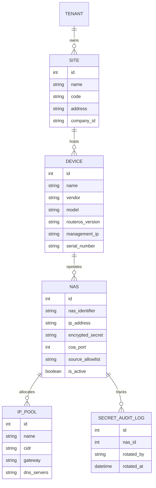

# Design: NEXUS Phase 1 — Network Inventory & MikroTik NAS Registry Foundation (Issue #8)

## 1. Domain Entity Relationship Diagram



---

## 2. API Schema Contracts

### 2.1 NAS Creation Request (`POST /v1/nexus/nas`)
```json
{
  "nas_identifier": "mikrotik-ccr2004-pop-a",
  "ip_address": "192.168.88.1",
  "secret": "s3cure-sh4red-k3y",
  "vendor": "mikrotik",
  "coa_port": 3799,
  "source_allowlist": ["192.168.88.0/24"],
  "site_id": 1
}
```

### 2.2 Redacted Response Envelope
```json
{
  "success": true,
  "data": {
    "id": 1,
    "nas_identifier": "mikrotik-ccr2004-pop-a",
    "ip_address": "192.168.88.1",
    "secret": "[REDACTED]",
    "vendor": "mikrotik",
    "coa_port": 3799,
    "source_allowlist": ["192.168.88.0/24"],
    "site_id": 1,
    "created_at": "2026-11-04T00:54:00Z"
  }
}
```

