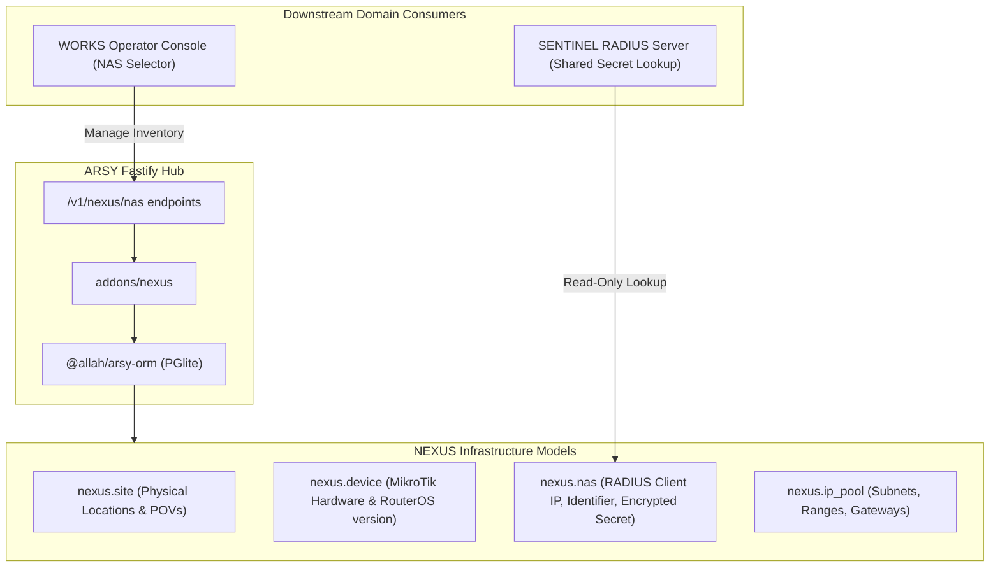

# SPEC: NEXUS Phase 1 — Network Inventory & MikroTik NAS Registry Foundation

## 1. Context & Purpose
- **Scope**: GitHub Issue #8 — `[NEXUS] Build network inventory and MikroTik NAS registry foundation`.
- **Purpose**: Create the canonical network infrastructure inventory in ARSY (`addons/nexus` or `@allah/arsy-plugin-nexus`) used by SENTINEL (for RADIUS client lookups) and future network tools.
- **Parent Master Issue**: GitHub Issue #5.
- **Dependencies**: Depends on Issue #6 audit baseline and Issue #7 domain contracts.

---

## 2. Requirements & Deliverables

### 2.1 Domain Models (`addons/nexus` or `@allah/arsy-orm`)
1. **`nexus.site`**: Physical location (name, code, address, coordinates, company_id). Reuses partner location semantics.
2. **`nexus.device`**: Network device asset (name, vendor `mikrotik`, model `CCR2004-16G-2S+`, routeros_version `7.14`, serial_number, management_ip, site_id, company_id).
3. **`nexus.nas`**: RADIUS client identity:
   - `nas_identifier`: Unique string identifier sent in RADIUS packets.
   - `ip_address`: IPv4 / IPv6 address of the NAS client.
   - `secret_hash` / `encrypted_secret`: AES-256-GCM encrypted shared secret (never returned in cleartext API responses).
   - `coa_port`: Default 3799 for MikroTik Disconnect/Change-of-Authorization.
   - `source_allowlist`: CIDR array of allowed source IP addresses for RADIUS requests.
   - `is_active`: Boolean status flag.
   - `company_id`: Tenant boundary.
4. **`nexus.ip_pool`**: IP address range for dynamic PPPoE client allocation (name, cidr, gateway, dns_servers, nas_id, company_id).

### 2.2 Shared-Secret Security & Lifecycle
- **Write-Only Input**: When creating or updating a NAS, secrets are accepted in write payloads but redacted (`[REDACTED]`) in all GET and list queries.
- **Encryption at Rest**: Stored using deterministic or AES-GCM envelope encryption tied to ARSY application master secret.
- **Secret Rotation**: Support versioned rotation history and audit logs in `nexus.nas_secret_log`.

### 2.3 Management APIs & SDK Methods
- Fastify Endpoints in ARSY:
  - `GET /v1/nexus/nas`: Filtered list of registered NAS clients (secrets redacted).
  - `POST /v1/nexus/nas`: Create new NAS client with encrypted secret.
  - `GET /v1/nexus/nas/:id`: Retrieve single NAS details (secret redacted).
  - `PUT /v1/nexus/nas/:id/secret`: Rotate NAS shared secret with audit record.
  - `GET /v1/nexus/pools`: List IP address pools.
- SDK Extension (`@allah/sdk`):
  - `mwClient.nexus.listNas()`, `mwClient.nexus.createNas()`, `mwClient.nexus.rotateSecret()`.

---

## 3. Non-Goals
1. No RADIUS packet processing or UDP sockets (SENTINEL domain, Issue #10).
2. No direct SSH/WinBox configuration deployment to MikroTik routers (FORGE domain, Issue #18).
3. No ping/SNMP telemetry monitoring (WATCHTOWER domain, Issue #17).

---

## 4. Acceptance Criteria
1. `nexus.nas` and `nexus.site` models registered in `@allah/arsy-orm` with schema migrations.
2. Secret values are never exposed in JSON API responses, debug logs, or error payloads.
3. Tenant isolation (`company_id`) enforced on all CRUD queries.
4. Unit and integration tests verify secret encryption, redaction, and authorization checks.
5. All monorepo quality gates pass 100%.

