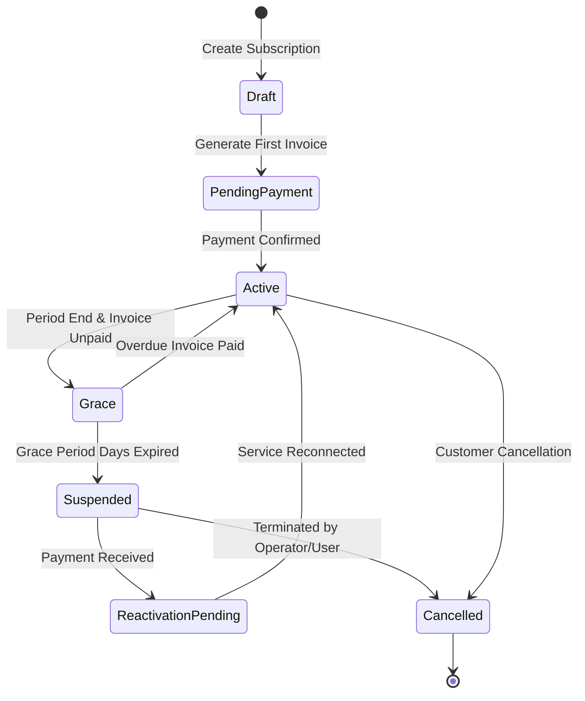

# Design: WORKS Phase 1 — ISP Commercial Foundation & Billing Lifecycle (Issue #9)

## 1. Subscription Lifecycle State Machine



---

## 2. API Contract Specifications

### 2.1 Subscription Activation Payload (`POST /v1/works/subscriptions/:id/activate`)
```json
{
  "payment_reference": "TXN_20261104_8892",
  "period_days": 30,
  "auto_renew": true
}
```

### 2.2 Entitlement Event Schema
```typescript
export interface IspSubscriptionEvent {
  event_type: 'isp.subscription.activated' | 'isp.subscription.suspended' | 'isp.subscription.grace_entered';
  subscription_id: number;
  subscription_number: string;
  partner_id: number;
  plan: {
    id: number;
    name: string;
    rate_limit: string; // e.g. "20M/50M"
  };
  status: 'active' | 'grace' | 'suspended' | 'expired';
  company_id: string;
  timestamp: string;
}
```

