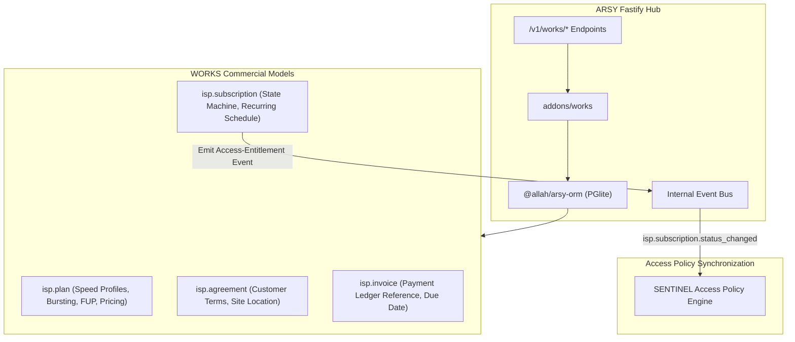

# SPEC: WORKS Phase 1 — ISP Commercial Foundation & Billing Lifecycle

## 1. Context & Purpose
- **Scope**: GitHub Issue #9 — `[WORKS] Build ISP commercial foundation: plans, subscribers, subscriptions and billing lifecycle`.
- **Purpose**: Implement the canonical commercial domain for ISP services inside WORKS/ARSY patterns, without turning SENTINEL into a billing engine.
- **Parent Master Issue**: GitHub Issue #5.
- **Dependencies**: Depends on Issue #6 audit baseline and Issue #7 canonical domain models.

---

## 2. Requirements & Deliverables

### 2.1 Commercial Domain Models (`addons/works` or `@allah/arsy-orm`)
1. **`isp.plan`**:
   - `name`: Display plan title (e.g., "Fiber Home 50Mbps").
   - `code`: Unique machine code (e.g., `FH-50M`).
   - `download_speed_kbps`: Maximum download rate (e.g., 51200).
   - `upload_speed_kbps`: Maximum upload rate (e.g., 20480).
   - `burst_rate`: Optional burst configuration string (MikroTik rate-limit compatible).
   - `quota_bytes`: Monthly FUP limit (0 for unlimited).
   - `fup_speed_kbps`: Throttled speed upon quota exhaustion.
   - `price_amount`: Monthly billing rate.
   - `currency_id`: Reference to `res.currency`.
   - `billing_cycle`: Enum (`monthly`, `quarterly`, `annually`).
   - `company_id`: Tenant isolation.
2. **`isp.subscription`**:
   - `subscription_number`: Unique sequential code (e.g., `SUB-2026-0001`).
   - `partner_id`: Customer reference (`res.partner`).
   - `plan_id`: Associated `isp.plan`.
   - `status`: State machine:
     `draft` $\rightarrow$ `pending_payment` $\rightarrow$ `active` $\rightarrow$ `grace` $\rightarrow$ `suspended` $\rightarrow$ `expired` $\rightarrow$ `cancelled` $\rightarrow$ `reactivation_pending`.
   - `current_period_start`: Timestamp.
   - `current_period_end`: Timestamp.
   - `grace_period_days`: Default grace period (e.g., 3 days).
   - `auto_renew`: Boolean.
   - `company_id`: Tenant isolation.
3. **`isp.invoice`**:
   - `invoice_number`: Unique invoice code.
   - `subscription_id`: Associated subscription.
   - `partner_id`: Billing customer.
   - `amount_total`: Payable total.
   - `amount_paid`: Recorded paid amount.
   - `status`: Enum (`draft`, `unpaid`, `paid`, `overdue`, `void`).
   - `due_date`: Timestamp.
   - `payment_reference`: External transaction reference (provider-neutral).
   - `company_id`: Tenant isolation.

### 2.2 Subscription State Machine & Entitlement Events
- State transition actions:
  - `activate(subscriptionId)`: Transitions to `active`, extends `current_period_end`, emits `isp.subscription.activated`.
  - `enterGrace(subscriptionId)`: Transitions to `grace` when past due date, emits `isp.subscription.grace_entered`.
  - `suspend(subscriptionId)`: Transitions to `suspended` when grace expires, emits `isp.subscription.suspended`.
  - `reactivate(subscriptionId)`: Transitions from `suspended` to `active` upon invoice settlement, emits `isp.subscription.reactivated`.
- Event payloads contain: `{ subscription_id, partner_id, username, plan_rate_limit, status, timestamp, company_id }`.
- **Zero Direct SQL Writing to SENTINEL**: WORKS never directly writes to RADIUS tables; all access synchronization is event-driven and decoupled.

### 2.3 Provider-Neutral Payment Contract
- Abstract payment gateway interface:
  - `createPaymentSession(invoiceId, provider)`: Returns checkout token/URL.
  - `handlePaymentWebhook(provider, payload)`: Validates signature and marks invoice `paid`.
- **No live payment gateway credentials or real transactions activated in this issue.**

---

## 3. Non-Goals
1. No RADIUS packet handling or session accounting (SENTINEL domain, Issues #10, #11, #12).
2. No real payment collection or production customer migration.
3. No duplicate ERP or second general ledger.

---

## 4. Acceptance Criteria
1. `isp.plan`, `isp.subscription`, and `isp.invoice` models registered in `@allah/arsy-orm`.
2. Subscription state machine transitions are deterministic, idempotent, and unit-tested.
3. Versioned access-entitlement events emitted cleanly onto ARSY event bus.
4. Tenant isolation (`company_id`) enforced across all commercial records.
5. All monorepo quality gates (`pnpm docs:check`, `pnpm lint:arch`, `pnpm typecheck`) pass 100%.

