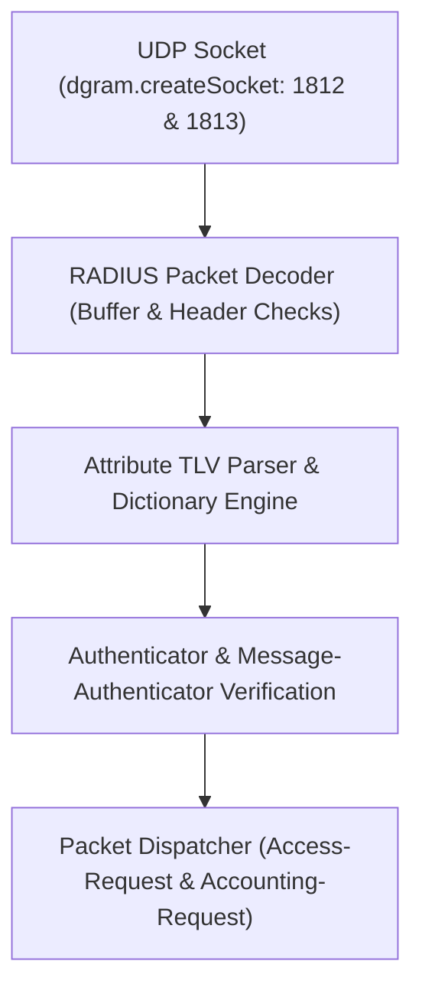

# SPEC: SENTINEL Phase 1 — Native RADIUS Protocol Core & Packet Test Suite

## 1. Context & Purpose
- **Scope**: GitHub Issue #10 — `[SENTINEL] Implement native RADIUS protocol core and packet test suite`.
- **Purpose**: Build the first independently testable native RADIUS engine in Node.js + TypeScript (`packages/sentinel-radius` or `apps/arsy/src/sentinel`). FreeRADIUS is strictly prohibited.
- **Protocol Target**: RFC 2865 (Authentication) and RFC 2866 (Accounting) packet codec, header/TLV parsing, authenticator verification, and UDP socket lifecycle.

---

## 2. Requirements & Deliverables

### 2.1 Native RADIUS Packet Codec
1. **Packet Parser (`parsePacket(buffer: Buffer)`)**:
   - Header validation: Code (1 byte), Identifier (1 byte), Length (2 bytes, 20 to 4096 octets), Authenticator (16 octets).
   - Attribute TLV extraction: Type (1 byte), Length (1 byte), Value (length - 2 octets).
   - Malformed / truncated packet rejection with clear error reason and zero exceptions.
2. **Packet Encoder (`encodePacket(packet: RadiusPacket, secret: string)`)**:
   - Serializes Header + Attributes into standard binary Buffer.
   - Calculates RFC 2865 Response Authenticator: $\text{MD5}(\text{Code} + \text{ID} + \text{Length} + \text{RequestAuth} + \text{Attributes} + \text{Secret})$.
3. **Standard Dictionary & Attributes**:
   - User-Name (1), User-Password (2), NAS-IP-Address (4), NAS-Port (5), Service-Type (6), Framed-Protocol (7), Framed-IP-Address (8), Reply-Message (18), NAS-Identifier (32), Acct-Status-Type (40), Acct-Session-Id (44), Vendor-Specific (26).

### 2.2 Security & Cryptographic Verifications
- Constant-time secret comparison (`crypto.timingSafeEqual`) to prevent timing attacks.
- Secure PAP password decryption: $\text{MD5}(\text{Secret} + \text{RequestAuth}) \oplus \text{Ciphertext}$.
- Strict redaction: Raw passwords and shared secrets must never appear in logs or error traces.

### 2.3 Standalone UDP Listener Daemon
- Standalone Node.js UDP socket server using `dgram`.
- Graceful startup and shutdown lifecycle, independent of Fastify HTTP server.

---

## 3. Acceptance Criteria
1. Packet codec passes golden RFC test vectors and malformed packet boundary fuzz tests.
2. Authenticator calculations independently verified against known test fixtures.
3. UDP server starts, binds to port (1812/1813), and shuts down cleanly.
4. No external FreeRADIUS dependency or sidecar.

