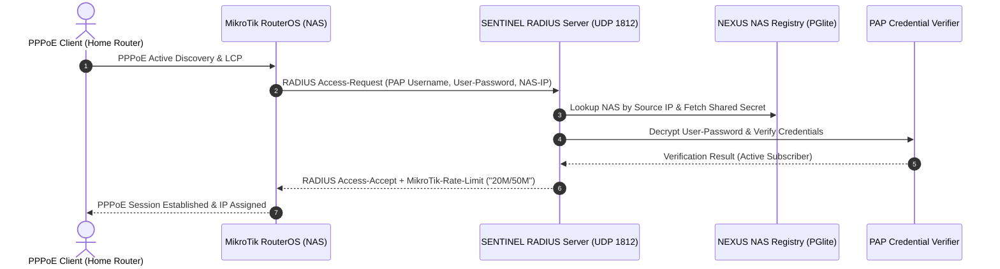

# SPEC: SENTINEL Phase 2 — MikroTik PPPoE PAP Authentication End-to-End

## 1. Context & Purpose
- **Scope**: GitHub Issue #11 — `[SENTINEL] Deliver MikroTik PPPoE PAP authentication end-to-end`.
- **Purpose**: Enable the first live network access path: MikroTik RouterOS PPPoE clients authenticating via PAP against native SENTINEL RADIUS and NEXUS NAS registry.

---

## 2. Requirements & Deliverables

### 2.1 MikroTik Vendor-Specific Attributes (VSA) Engine
- Vendor ID: `14988` (MikroTik).
- VSA parsing and encoding:
  - `MikroTik-Recv-Limit` (1)
  - `MikroTik-Xmit-Limit` (2)
  - `MikroTik-Rate-Limit` (8): Format `rx-rate[/tx-rate] [rx-burst-rate[/tx-burst-rate]] ...` (e.g., `20M/50M`).
  - `MikroTik-Group` (3)

### 2.2 NEXUS NAS Lookup & Shared Secret Resolution
- When an `Access-Request` arrives, resolve the NAS record by `packet.remoteAddress` and verify the request authenticator against the stored decrypted secret.
- Reject requests from unlisted or inactive NAS IPs immediately (`Access-Reject` with log warning).

### 2.3 PAP Credential Verification Strategy
- Subscriber network credentials stored in `sentinel.account`:
  - Username: e.g. `user@isp.net`.
  - Stored credential: Encrypted at rest using AES-256-GCM (reversible for PAP MD5 verification, distinct from one-way bcrypt platform hashes).

### 2.4 End-to-End Integration Test Harness
- Automated test script simulating a MikroTik PPPoE PAP authentication sequence and verifying `Access-Accept` with rate limits.

---

## 3. Acceptance Criteria
1. MikroTik `Access-Request` with PAP is correctly parsed and authenticated.
2. `Access-Accept` returns valid `MikroTik-Rate-Limit` VSA matching the subscriber's active plan.
3. Invalid passwords return deterministic `Access-Reject`.
4. All secrets and subscriber passwords remain redacted.

