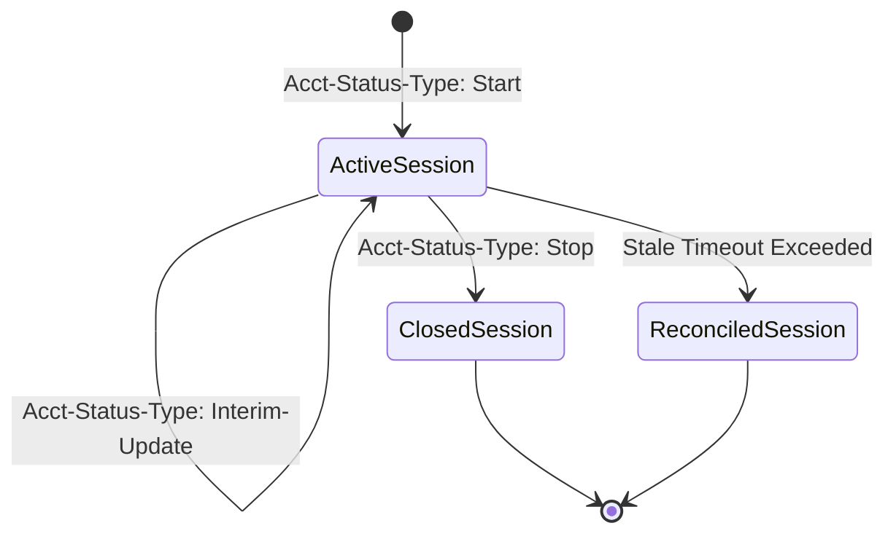

# Design: SENTINEL Phase 3 — RADIUS Accounting & Subscriber Session Lifecycle (Issue #12)

## 1. Accounting Lifecycle State Transition



---

## 2. Session Data Contract
```typescript
export interface SentinelSessionRecord {
  id: number;
  nas_ip: string;
  acct_session_id: string;
  username: string;
  framed_ip?: string;
  calling_station_id?: string; // MAC address
  start_time: string;
  last_interim_time?: string;
  stop_time?: string;
  input_octets: number;
  output_octets: number;
  session_time_seconds: number;
  terminate_cause?: string;
  status: 'active' | 'closed' | 'reconciled';
  company_id: string;
}
```

