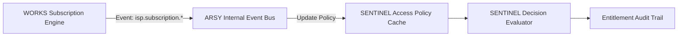

# SPEC: ISP Integration Phase 1 — Synchronize WORKS Entitlement with SENTINEL Access Policy

## 1. Context & Purpose
- **Scope**: GitHub Issue #13 — `[INTEGRATION] Synchronize WORKS subscription entitlement with SENTINEL access policy`.
- **Purpose**: Connect the commercial subscription lifecycle in WORKS to network access decisions in SENTINEL without direct cross-domain database coupling, ensuring access policy converges deterministically and safely.

---

## 2. Requirements & Deliverables

### 2.1 Event-Driven Policy Synchronization
1. **Event Consumers**:
   - `isp.subscription.activated`: Generates/updates access policy allowing connection with plan bandwidth limits.
   - `isp.subscription.grace_entered`: Updates policy to throttle bandwidth or inject captive portal notice.
   - `isp.subscription.suspended`: Updates policy to `Access-Reject` or isolated pool assignment.
   - `isp.subscription.cancelled` / `expired`: Revokes access immediately.
2. **COA / Disconnect Integration**:
   - When a subscriber is suspended, optionally issue a Disconnect-Request (RFC 3576 / RFC 5176) to the active NAS to terminate current PPPoE session instantly.

### 2.2 Cache Resilience & Outage Policy
- **In-Memory Policy Cache**: Lookups during RADIUS authentication occur in $\le 5\text{ms}$.
- **Outage / Fail-Safe Behavior**: If policy lookup encounters temporary database unavailability, apply configured policy (fail-closed by default for unauthenticated subscribers; preserve existing established sessions).

---

## 3. Acceptance Criteria
1. Subscription state transitions in WORKS update SENTINEL access decisions within 500ms.
2. Zero direct cross-domain SQL queries between WORKS and SENTINEL.
3. Full audit trail connects invoice settlement $\rightarrow$ subscription update $\rightarrow$ RADIUS decision.

