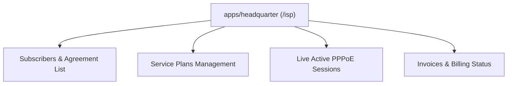

# SPEC: WORKS Frontend Phase 1 — ISP Operator Workspace

## 1. Context & Purpose
- **Scope**: GitHub Issue #14 — `[WORKS FRONTEND] Build ISP operator workspace using existing Moon UI`.
- **Purpose**: Deliver the ISP operator experience within the existing command center architecture (`apps/headquarter/src/app/isp` or `apps/headquarter`), avoiding a separate frontend deployment unless proven necessary.
- **UI Purity**: 100% `@moonwitness/ui` components (`Button`, `Card`, `Badge`, `Input`, `EcosystemNavbar`).

---

## 2. Requirements & Deliverables

### 2.1 Operator Workflows & Views
1. **Subscriber Management (`/isp/subscribers`)**:
   - List subscribers with status badge (`active`, `grace`, `suspended`).
   - Customer detail view with active plan, assigned PPPoE username, and framed IP.
   - Operator actions: Manual suspension, grace extension, or service reactivation.
2. **Plans & Rates (`/isp/plans`)**:
   - Bandwidth tier configurations (download/upload speed, burst, pricing).
3. **Live Session Monitor (`/isp/sessions`)**:
   - Real-time active sessions fetched from authorized SENTINEL projection APIs.
   - Shows uptime, upload/download octets, and NAS IP.
   - Operator action: "Disconnect Session" button.
4. **Billing Overview (`/isp/invoices`)**:
   - Unpaid vs paid invoices with settlement status.

---

## 3. Acceptance Criteria
1. Operator can perform full ISP lifecycle workflows (view subscribers, update plans, trigger disconnects).
2. Zero duplicate business logic in client; all state updates route through `@allah/sdk`.
3. Passes `pnpm lint:arch` (UI purity strictly verified).
4. Responsive across desktop, tablet, and mobile.

