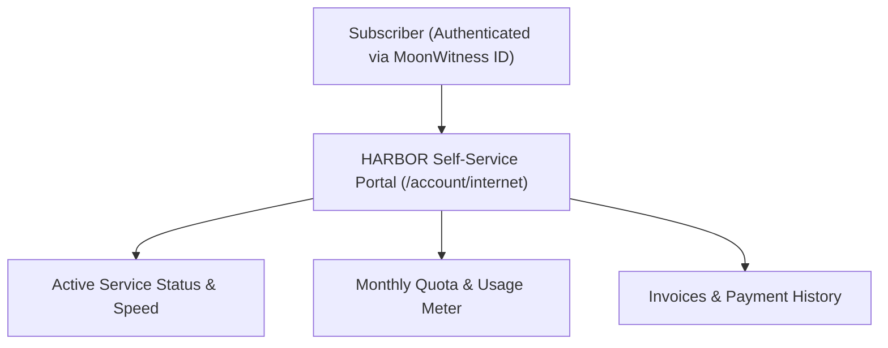

# SPEC: HARBOR Phase 1 — ISP Customer Self-Service Experience

## 1. Context & Purpose
- **Scope**: GitHub Issue #15 — `[HARBOR] Build ISP customer self-service experience`.
- **Purpose**: Provide internet subscribers with a focused self-service portal (integrated into public user portal / Dock / ID or dedicated harbor route), allowing customers to view service status, plan details, payment history, and bandwidth usage summaries securely.
- **Reused Foundations**: MoonWitness ID (`apps/id`) for SSO authentication, `@moonwitness/ui` for components, and `@allah/sdk` for API calls.

---

## 2. Requirements & Deliverables

### 2.1 Customer Views & Self-Service Workflows
1. **Service Overview (`/account/internet`)**:
   - Connection status indicator (Active: emerald, Suspended: red, Grace: amber).
   - Plan details: Active plan name, download/upload speeds, renewal date.
   - Live session indicator (Online / Offline, Framed IP address).
2. **Usage & FUP Quota Meter**:
   - Visual progress bar showing download/upload octets consumed in the current billing cycle.
   - FUP warning if approaching threshold.
3. **Invoices & Payment Status**:
   - List of monthly invoices with download receipt option.
   - Neutral "Pay Now" placeholder action for unpaid invoices.

### 2.2 Security & Data Isolation
- Customer can only see their own subscriber records.
- NAS IPs, shared secrets, internal routing topologies, and other subscribers' data are strictly withheld server-side.

---

## 3. Acceptance Criteria
1. Subscriber can inspect service status, active plan, validity date, and usage summary.
2. Tenant and customer data isolation verified by automated unit tests.
3. All UI components sourced exclusively from `@moonwitness/ui`.
4. Responsive design passes mobile, tablet, and desktop reviews.

