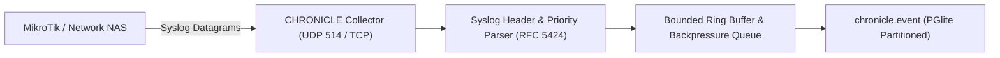

# SPEC: CHRONICLE Phase 1 — Bounded Syslog Collector & Normalized Event Foundation

## 1. Context & Purpose
- **Scope**: GitHub Issue #16 — `[CHRONICLE] Build bounded syslog collector and normalized event foundation`.
- **Purpose**: Provide a dedicated network syslog ingestion capability (RFC 3164 / RFC 5424) in Node.js (UDP port 514 / TCP port 6514) separate from Fastify HTTP routes and separate from internal Pino application logging.
- **Role**: Ingest and normalize network router/switch events (link-down, BGP flaps, PPPoE disconnects) into a structured schema without overwhelming memory or storage.

---

## 2. Requirements & Deliverables

### 2.1 Syslog Ingestion Runtime (`packages/chronicle-syslog` or `apps/arsy/src/chronicle`)
1. **Network Protocol Listeners**:
   - Standalone Node.js UDP socket (`dgram`) on port `514` (configurable).
   - Optional TCP stream listener with message framing.
   - Do NOT route syslog datagrams through Fastify HTTP routes.
2. **Parser & Normalization**:
   - RFC 3164 (BSD syslog) and RFC 5424 parsing: Priority (`PRIVAL = Facility * 8 + Severity`), Timestamp, Hostname/Source IP, Tag/AppName, ProcessID, Message body.
   - Normalization envelope: `{ id, nas_id, source_ip, facility, severity, received_at, event_at, raw_message, parsed_data, company_id }`.

### 2.2 Memory Bounds & Backpressure
- Fixed-size ring buffer / bounded ingestion queue (max 5,000 pending events).
- Drop policy with logged metrics when saturated (`drop_count_total`) to prevent Node.js OOM crashes during network event storms.

### 2.3 Storage Model (`chronicle.event`)
- Stored in PGlite with automated retention pruning (e.g. 14 days default).
- Tenant isolation enforced via `company_id`.

---

## 3. Acceptance Criteria
1. UDP/TCP syslog packets correctly ingested, parsed, and recorded into `chronicle.event`.
2. Malformed packets handled gracefully without crashing the daemon.
3. High-throughput bursts trigger bounded backpressure without unbounded memory growth.
4. Tenant isolation and source NAS resolution verified by tests.

