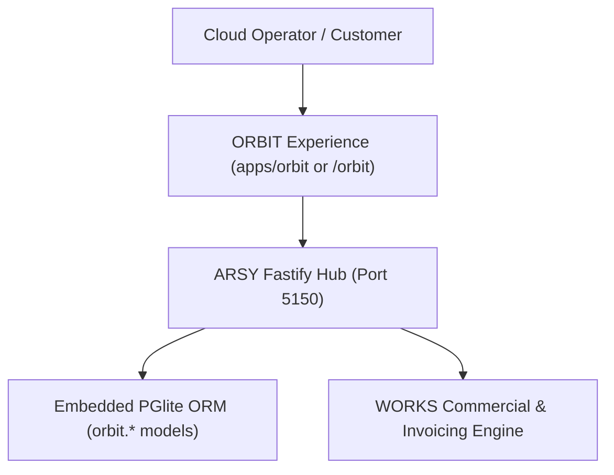

# SPEC: ORBIT Phase 1 — Cloud Compute & Hosting Customer Experience

## 1. Context & Architecture Goal
- **Product Domain**: **ORBIT** (Cloud, Compute, Virtual Machines, Containers, and Hosting Customer Experience within the A-L-L-A-H.COM ecosystem).
- **Backend Authority**: Single backend authority via **ARSY Fastify Hub** (`apps/arsy`) with embedded PGlite ORM.
- **Identity & SSO**: Single sign-on routed through **MoonWitness ID** (`apps/id`).
- **UI Purity**: 100% atomic design system via `@moonwitness/ui`.

---

## 2. Requirements & Deliverables

### 2.1 Compute & Hosting Domain Models (`orbit.*`)
1. **`orbit.instance`**: Virtual compute instances (name, cpu_cores, ram_mb, disk_gb, status: `provisioning`, `running`, `stopped`, `terminated`, ip_address, partner_id, company_id).
2. **`orbit.template`**: OS images (Debian 12, Ubuntu 24.04, Alpine, custom CAS image hash).
3. **`orbit.volume`**: Block storage volumes (size_gb, attach_instance_id, iops_tier).

### 2.2 Commercial Metering & Invoicing Integration
- Integrates with WORKS commercial domain (`isp.plan` / cloud tier pricing).
- Usage metering based on hourly compute runtime records stored in PGlite.

---

## 3. Acceptance Criteria
1. Domain models defined with strict multi-tenant isolation (`company_id`).
2. Instance state transitions are idempotent and auditable.
3. Zero secondary databases or external hypervisor writes during the foundation milestone.
4. Monorepo quality gates (`pnpm docs:check`, `pnpm lint:arch`, `pnpm typecheck`) pass 100%.

