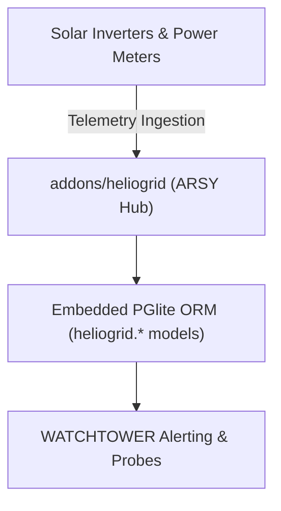

# SPEC: HELIOGRID Phase 1 — Energy & Physical Infrastructure Foundation

## 1. Context & Architecture Goal
- **Product Domain**: **HELIOGRID** (Energy, Solar/Power Inverters, Battery Energy Storage Systems (BESS), and Physical Utility Infrastructure within the A-L-L-A-H.COM ecosystem).
- **Backend Authority**: Single backend authority via **ARSY Fastify Hub** (`apps/arsy`) with embedded PGlite ORM.
- **Role**: Track physical power generation, consumption metrics, battery state of charge (SoC), and grid status for network POPs and partner sites.

---

## 2. Requirements & Deliverables

### 2.1 Energy & Physical Infrastructure Models (`heliogrid.*`)
1. **`heliogrid.site`**: Physical power site reference tied to `nexus.site`.
2. **`heliogrid.inverter`**: Power conversion asset (capacity_kw, model, serial, status).
3. **`heliogrid.battery`**: Storage unit (capacity_kwh, state_of_charge_percent, cycle_count).
4. **`heliogrid.telemetry`**: Time-series log (solar_generation_kw, battery_discharge_kw, grid_import_kw, site_consumption_kw, recorded_at, company_id).

### 2.2 Alerting & Incident Integration
- Power anomalies (e.g. SoC drop below 20%, grid failure) emit events consumed by WATCHTOWER for operator alerting.

---

## 3. Acceptance Criteria
1. Telemetry ingestion validates energy data bounds without schema corruption.
2. Low-battery triggers emit incident notifications to WATCHTOWER.
3. Multi-tenant isolation enforced on all physical site telemetry.
4. Monorepo quality gates (`pnpm docs:check`, `pnpm lint:arch`, `pnpm typecheck`) pass 100%.

