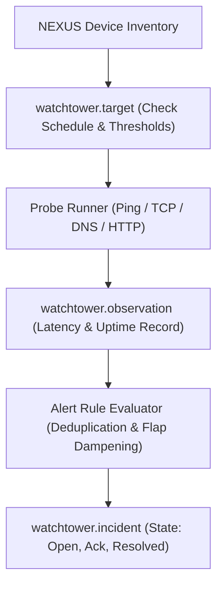

# SPEC: WATCHTOWER Phase 1 — Monitoring Targets, Probes, Alerts & Incidents

## 1. Context & Purpose
- **Scope**: GitHub Issue #17 — `[WATCHTOWER] Define monitoring targets, probes, alerts and incident lifecycle`.
- **Purpose**: Create network monitoring control-plane foundations for NEXUS devices and ISP services (ICMP ping, HTTP, TCP port checks), managing alert deduplication, incident creation, and operator acknowledgement.
- **Boundaries**: Uses NEXUS for device identities; consumes CHRONICLE for event triggers; does not own raw syslog or duplicate hardware master data.

---

## 2. Requirements & Deliverables

### 2.1 Monitoring Models (`addons/watchtower` or `@allah/arsy-orm`)
1. **`watchtower.target`**:
   - `device_id`: Reference to `nexus.device` or `nexus.nas`.
   - `check_type`: Enum (`icmp_ping`, `tcp_port`, `http_status`, `dns_resolve`).
   - `interval_seconds`: Probe frequency (e.g. 30s).
   - `timeout_ms`: Maximum probe wait (e.g. 2000ms).
   - `failure_threshold`: Consecutive failures before alerting (e.g. 3).
2. **`watchtower.observation`**:
   - Timestamped probe result: `{ target_id, is_up, latency_ms, error_message, timestamp, company_id }`.
3. **`watchtower.alert` & `watchtower.incident`**:
   - Status: `open` $\rightarrow$ `acknowledged` $\rightarrow$ `resolved`.
   - Flap dampening: Avoid alert storms during rapid intermittent connection toggling.

### 2.2 Probe Execution Scheduler
- Lightweight Node.js probe scheduler using existing ARSY async worker primitives.
- Non-blocking I/O (native `net.Socket` and non-privileged ICMP / TCP checks).

---

## 3. Acceptance Criteria
1. Target checks execute at configured intervals and record observations in PGlite.
2. Consecutive failures generate deduplicated alerts without alert storms.
3. Incidents track full lifecycle: creation, operator acknowledgement, and auto-resolution upon recovery.
4. Tenant isolation enforced across all monitoring targets.

