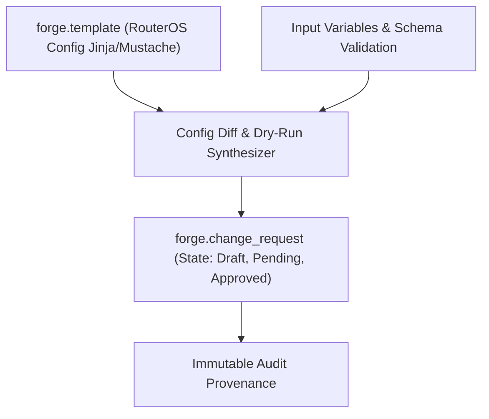

# SPEC: FORGE Phase 1 — Safe Network Configuration Templates & Approval Foundation

## 1. Context & Purpose
- **Scope**: GitHub Issue #18 — `[FORGE] Build safe network configuration template and approval foundation`.
- **Purpose**: Establish desired configuration management for MikroTik RouterOS devices (e.g. PPPoE server profiles, interface lists, firewall address-lists) using versioned templates, parameter validation, dry-run diffs, and multi-eye approval workflows.
- **Explicit Boundary**: Real device SSH / API execution writes are explicitly **disabled/deferred** in this foundation phase. Only template synthesis, dry-run validation, and approval records are built.

---

## 2. Requirements & Deliverables

### 2.1 Configuration Template Engine
1. **`forge.template`**:
   - `vendor`: `mikrotik`.
   - `target_os_version`: `7.x`.
   - `content`: Parameterized template (e.g. `/interface pppoe-server server add service-name={{service_name}} interface={{interface}}`).
   - `variables_schema`: JSON Schema defining required parameters and types.
   - `version`: Sequential integer versioning (templates are immutable once published).
2. **`forge.change_request`**:
   - `device_id`: Target `nexus.device`.
   - `template_id`: Applied template.
   - `rendered_config`: Synthesized configuration script.
   - `diff_preview`: Visual diff of additions and deletions.
   - `status`: `draft` $\rightarrow$ `pending_approval` $\rightarrow$ `approved` $\rightarrow$ `rejected` $\rightarrow$ `cancelled`.
   - `approved_by`: Operator user ID.

### 2.2 Security & No-Write Enforcement
- The execution adapter is a mock dry-run stub. Any attempt to write to real hardware triggers a safety guard exception.

---

## 3. Acceptance Criteria
1. Templates render deterministic RouterOS configuration scripts from input variables.
2. Synthesizer generates accurate diff previews.
3. Approval workflow strictly enforces role-based authorization before marking a change approved.
4. Zero writes executed against live network hardware.

