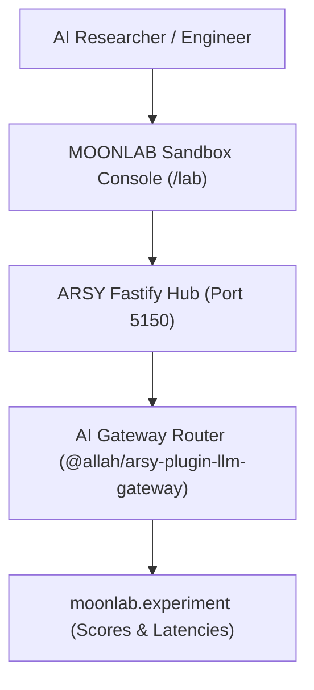

# SPEC: MOONLAB Phase 1 — Research, Experimentation & AI Sandbox Foundation

## 1. Context & Architecture Goal
- **Product Domain**: **MOONLAB** (Research, Experimentation, AI Sandbox, Prompt Benchmarks, and Model Evaluations within the A-L-L-A-H.COM ecosystem).
- **Backend Authority**: Single backend authority via **ARSY Fastify Hub** (`apps/arsy`) leveraging `@allah/arsy-plugin-llm-gateway`.
- **Role**: Sandbox environment for testing multi-model routing, prompt evaluations, synthetic dataset generation, and cognitive agent behaviors without affecting production tenant quotas.

---

## 2. Requirements & Deliverables

### 2.1 Research & Evaluation Models (`moonlab.*`)
1. **`moonlab.experiment`**: Evaluation run (name, target_model_ids, test_dataset_id, status: `draft`, `running`, `completed`).
2. **`moonlab.benchmark`**: Evaluation metrics (accuracy_score, latency_p95_ms, cost_per_query, consistency_score).
3. **`moonlab.dataset`**: Synthetic / curated test prompts with expected outputs.

### 2.2 LLM Gateway Sandbox Integration
- Connects directly to SmartRouter to evaluate prompt completions across OpenAI, Anthropic, Gemini, and Ollama side-by-side.

---

## 3. Acceptance Criteria
1. Side-by-side model comparison benchmarking executes cleanly via Fastify Hub.
2. Experiments and benchmark scores recorded in PGlite with tenant isolation.
3. Monorepo quality gates (`pnpm docs:check`, `pnpm lint:arch`, `pnpm typecheck`) pass 100%.

