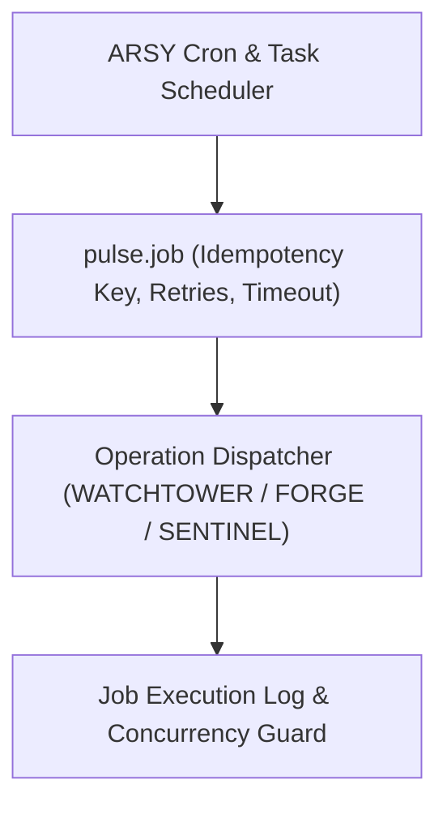

# SPEC: PULSE Phase 1 — Network Operation Job Lifecycle

## 1. Context & Purpose
- **Scope**: GitHub Issue #19 — `[PULSE] Build network operation job lifecycle using existing ARSY facilities`.
- **Purpose**: Orchestrate scheduled and event-driven network operations (e.g. periodic session reconciliation, bulk probe execution, configuration dry-runs) using existing ARSY asynchronous task primitives without introducing external queues (Redis/BullMQ) or duplicating AI agent swarm logic.

---

## 2. Requirements & Deliverables

### 2.1 Network Job Lifecycle Model (`pulse.job`)
- `operation_type`: Enum (`session_reconciliation`, `probe_sweep`, `dryrun_validation`, `quota_reset`).
- `status`: `pending` $\rightarrow$ `running` $\rightarrow$ `completed` $\rightarrow$ `failed` $\rightarrow$ `cancelled`.
- `idempotency_key`: Prevents duplicate executions of the same batch operation.
- `max_attempts`: Bounded retries with exponential backoff (e.g. 3 attempts).
- `timeout_seconds`: Hard execution ceiling.
- `concurrency_limit`: Max parallel jobs per tenant to prevent resource starvation.

### 2.2 Execution Engine
- Pure Node.js / TypeScript in-process worker queue utilizing PGlite row-level status updates (`SKIP LOCKED` or atomic state transitions).
- Zero external dependencies: no Redis, RabbitMQ, or Kafka.

---

## 3. Acceptance Criteria
1. Scheduled and on-demand network operations execute idempotently.
2. Failed jobs retry with backoff up to max attempts, then mark as `failed`.
3. Operator can cancel queued or running jobs.
4. Tenant fairness and concurrency limits are enforced.

