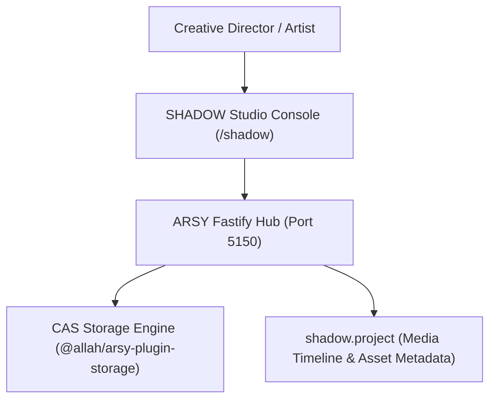

# SPEC: SHADOW Phase 1 — Creative Production & Asset Pipeline Foundation

## 1. Context & Architecture Goal
- **Product Domain**: **SHADOW** (Creative Production, Media Generation, Video/Audio Synthesis Pipelines, and Visual Asset Orchestration within the A-L-L-A-H.COM ecosystem).
- **Backend Authority**: Single backend authority via **ARSY Fastify Hub** (`apps/arsy`) with Content-Addressed Storage (`@allah/arsy-plugin-storage`).
- **Role**: Creative asset workflow manager tracking media projects, rendering tasks, generative prompts, and immutable CAS storage hashes for art/music production.

---

## 2. Requirements & Deliverables

### 2.1 Creative Production Models (`shadow.*`)
1. **`shadow.project`**: Creative production container (title, genre, status: `concept`, `production`, `mastered`, partner_id).
2. **`shadow.asset`**: Production artifact (name, media_type: `audio`, `video`, `image`, `script`, cas_hash, size_bytes).
3. **`shadow.generation_task`**: Generative rendering job (prompt, model, seed, parameters, output_asset_id).

### 2.2 Content-Addressed Storage (CAS) Integration
- All produced media files are stored with SHA-256 deduplication and legal-hold support via `addons/mw_storage`.

---

## 3. Acceptance Criteria
1. Media assets stored and retrieved via verified SHA-256 content hashes.
2. Production projects and generation task records maintained in PGlite with tenant isolation.
3. Monorepo quality gates (`pnpm docs:check`, `pnpm lint:arch`, `pnpm typecheck`) pass 100%.

