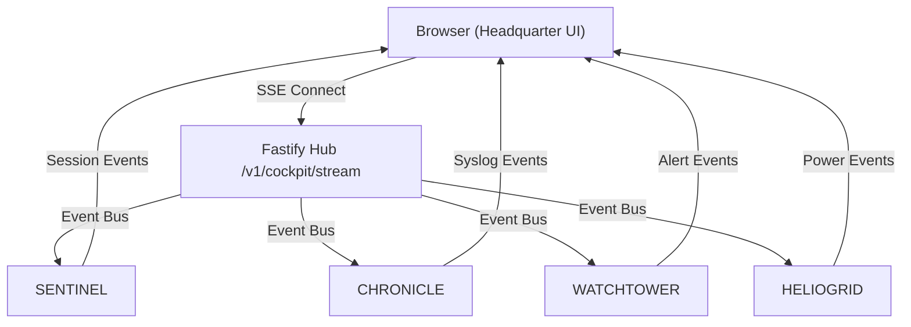

# DESIGN

## UI Architecture
- **Page**: `/cockpit` hosted in `apps/headquarter` (Next.js App Router).
- **Layout**: 4‑panel grid (responsive, 2×2 on desktop, stacked on mobile).
- **Components**: All panels built from atomic UI primitives in `@moonwitness/ui` (e.g., `Card`, `Chart`, `Table`, `Badge`).
- **State Management**: Global event store via `@allah/sdk` subscription to SSE stream; each panel consumes a slice of the store.
- **Accessibility**: Keyboard‑navigable panel focus, ARIA live regions for critical alerts.

## Panel Details
| Panel | Purpose | Key Elements |
|-------|---------|--------------|
| **A** – Sessions & Bandwidth | Live throughput graph, total PPPoE users | `LineChart`, `StatCard` |
| **B** – Incident Radar | Real‑time alerts with severity, acknowledge button | `AlertList`, `Badge` |
| **C** – Syslog Stream | High‑speed tail of syslog entries, search/filter | `VirtualizedTable`, `SearchBox` |
| **D** – Device Matrix | Rack/POP health matrix, status colors | `Grid`, `StatusDot` |

## Data Flow Diagram

## Interaction States
- **Loading**: UI shows skeleton placeholders until SSE connection established.
- **Connected**: Live panels receive events; reconnection logic on network drop.
- **Error**: Global toast with retry button; individual panels display fallback state.
- **Acknowledgement**: Clicking an alert sends POST to `/v1/incident/ack` via SDK, updates UI instantly.

## Performance Considerations
- Event throttling: max 100 events/sec per client.
- Virtualized rendering for syslog panel to handle high volume.
- Use `requestIdleCallback` for non‑critical UI updates.

---

## Acceptance Criteria (Design)
1. UI renders correctly on Chrome/Edge latest versions at 1920×1080 resolution.
2. No layout shift > 0.1 during live updates (CLS < 0.1).
3. Keyboard navigation works across all panels.
4. Screen‑reader announces new critical alerts via ARIA live region.
