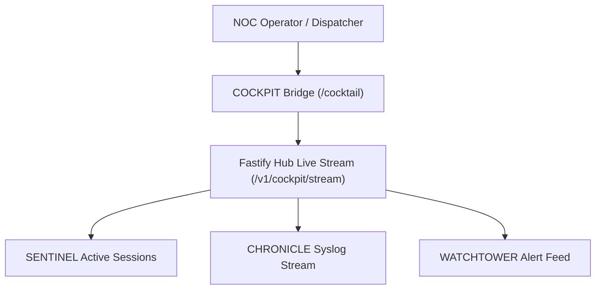

# Design: COCKPIT Phase 1 — High-Density Real-Time Operations Console

## 1. Context & Architecture Goal
- **Product Domain**: COCKPIT (High-Density, Multi-Monitor, Real-Time Mission-Critical Operations Console within the A-L-L-A-H.COM ecosystem).
- **Distinction from Headquarter**: While Headquarter serves governance, admin forms, and business review, COCKPIT provides a dedicated, low-latency, real-time command bridge designed for live network dispatchers, NOC engineers, and infrastructure operators.
- **Backend Authority**: Single backend authority via ARSY Fastify Hub (apps/arsy:5150) with live WebSocket / SSE event feeds from SENTINEL, CHRONICLE, and WATCHTOWER.
- **UI Purity**: 100% atomic components via @moonwitness/ui with specialized high-density HUD tokens.

## 2. Architecture Diagram

## 3. Component Structure
- **Dashboard Layout**: Four-panel high-density layout (Active Sessions, Incident Radar, Syslog Stream, Network Device Matrix)
- **UI Components**: All via @moonwitness/ui - specialized HUD tokens for COCKPIT
- **Backend Integration**: ARSY Fastify Hub endpoints for real-time data streaming

## 4. Technical Specifications
- **Real-Time Feed**: SSE stream with sub-second latency aggregating events from SENTINEL, CHRONICLE, and WATCHTOWER
- **High-Density UI**: Maintain ≥60fps rendering without memory leaks during event bursts
- **Operator Actions**: Idempotent execution via @allah/sdk (Acknowledge Incident, Terminate Session)