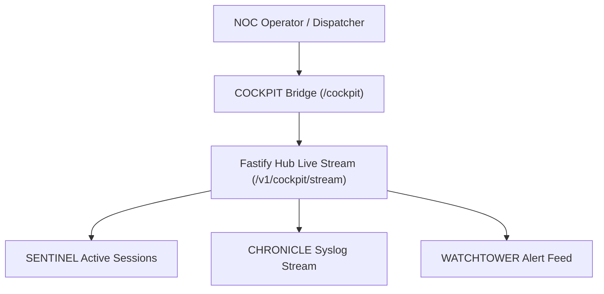

# SPEC: COCKPIT Phase 1 — High-Density Real-Time Operations Console

## 1. Context & Architecture Goal
- **Product Domain**: **COCKPIT** (High-Density, Multi-Monitor, Real-Time Mission-Critical Operations Console within the A-L-L-A-H.COM ecosystem).
- **Distinction from Headquarter**: While Headquarter (`apps/headquarter`) serves governance, admin forms, and business review, **COCKPIT** provides a dedicated, low-latency, real-time command bridge designed for live network dispatchers, NOC engineers, and infrastructure operators.
- **Backend Authority**: Single backend authority via **ARSY Fastify Hub** (`apps/arsy:5150`) with live WebSocket / SSE event feeds from SENTINEL, CHRONICLE, and WATCHTOWER.
- **UI Purity**: 100% atomic components via `@moonwitness/ui` with specialized high-density HUD tokens.

---

## 2. Requirements & Deliverables

### 2.1 Real-Time Operations Telemetry Feed
1. **Unified Stream (`GET /v1/cockpit/stream`)**:
   - Zero-copy Server-Sent Events delivering aggregated network events:
     - `session_connect` / `session_disconnect` (from SENTINEL).
     - `syslog_critical` / `syslog_error` (from CHRONICLE).
     - `incident_trigger` / `incident_resolve` (from WATCHTOWER).
     - `power_warning` (from HELIOGRID).

### 2.2 High-Density Multi-Panel Dashboard Layout
- **Panel A (Active Sessions & Bandwidth Speedometer)**: Live throughput graph and total connected PPPoE users.
- **Panel B (Live Incident Radar)**: Active severity-ranked alerts with one-click acknowledgement.
- **Panel C (Real-Time Syslog Stream)**: High-speed tail of incoming network events with regex search and level filters.
- **Panel D (Network Device Matrix)**: Visual rack / POP health indicators.

---

## 3. Acceptance Criteria
1. SSE stream aggregates events from SENTINEL, CHRONICLE, and WATCHTOWER with sub-second latency.
2. High-density UI maintains $\ge 60\text{fps}$ rendering without memory leaks during event bursts.
3. Operator actions (Acknowledge Incident, Terminate Session) execute idempotently via `@allah/sdk`.
4. Monorepo quality gates (`pnpm docs:check`, `pnpm lint:arch`, `pnpm typecheck`) pass 100%.

