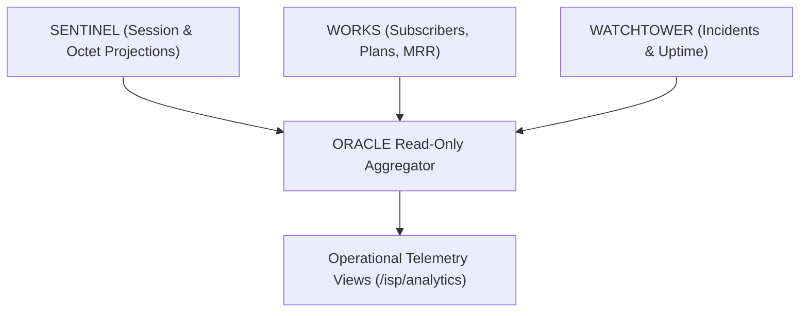

# SPEC: ORACLE Phase 1 — Read-Only Network & ISP Analytics Projections

## 1. Context & Purpose
- **Scope**: GitHub Issue #20 — `[ORACLE] Build read-only network and ISP analytics projections`.
- **Purpose**: Provide evidence-based operational and commercial intelligence across network domains (active subscriber counts, bandwidth peak throughput, churn rate, plan distribution, incident MTTR) without owning source-of-truth data or duplicating tables.
- **Explicit Boundary**: Read-only aggregation. Revenue figures reconcile strictly to WORKS (never RADIUS accounting).

---

## 2. Requirements & Deliverables

### 2.1 Analytics Projections & Metrics
1. **Commercial KPI Projections**:
   - Active Subscribers count and Net Churn rate (from `isp.subscription`).
   - Monthly Recurring Revenue (MRR) and collection rate (from `isp.invoice`).
2. **Network Bandwidth Projections**:
   - Aggregate upload and download bytes per time window (from `sentinel.session`).
   - Peak concurrent sessions and average session duration.
3. **Reliability & Service Health**:
   - Device uptime percentages and Mean Time To Recovery (MTTR) (from `watchtower.incident`).
   - Syslog error rates (from `chronicle.event`).

### 2.2 Provenance & Methodology
- Every metric returned includes: `{ metric_name, value, unit, time_window, source_domain, calculation_version, fresh_until }`.
- AI-assisted interpretations (via `@allah/arsy-plugin-llm-gateway`) are explicitly labeled as `generated_interpretation`, distinguished from observed factual metrics.

---

## 3. Acceptance Criteria
1. Metrics aggregate across multiple domains without cross-domain table mutation.
2. Revenue values reconcile 100% to WORKS invoice records, not network byte counters.
3. Query response times for dashboard summaries are $\le 250\text{ms}$.
4. Strict multi-tenant isolation enforced on all projections.

