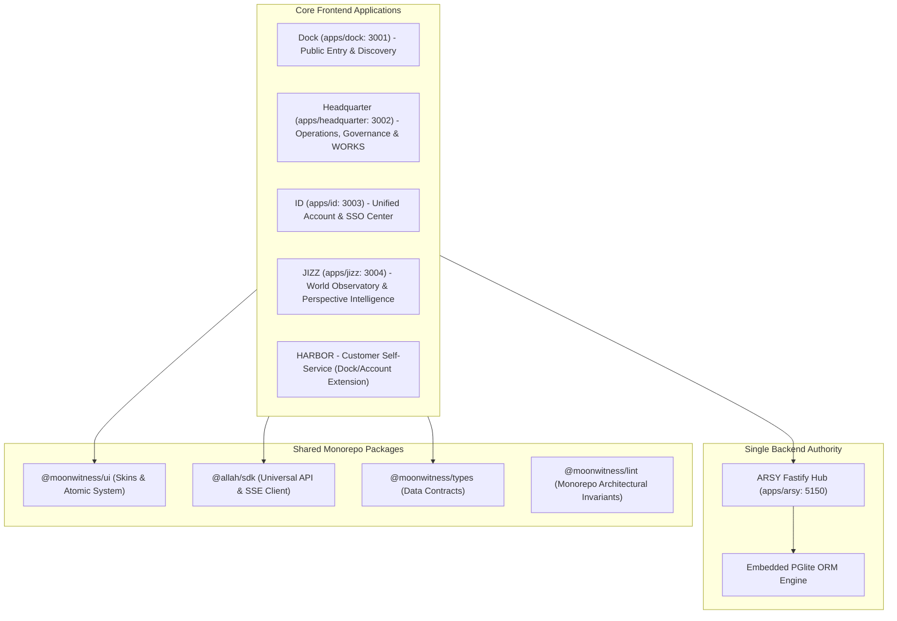

# SPEC: Ecosystem Architecture Phase 1 — Product Application Boundaries & Naming Canon

## 1. Context & Purpose
- **Scope**: GitHub Issue #21 — `[ECOSYSTEM ARCHITECTURE] Finalize product application boundaries and naming canon`.
- **Purpose**: Reconcile the A-L-L-A-H.COM product application ecosystem so distinct business and customer journeys have clear frontend application identities without fragmenting shared SSO, backend authority (ARSY), shared types, or UI components.
- **Rule**: Distinct user journeys may justify separate apps; however, distinct apps do NOT imply separate backends or databases. ARSY Fastify Hub remains the singular backend authority.

---

## 2. Requirements & Deliverables

### 2.1 Canonical Application Portfolio Matrix
| Product / Identity | Path / Port | Purpose & User Journey | Backend Authority |
|---|---|---|---|
| **A-L-L-A-H.COM / LIGHTHOUSE** | Global domain | Ecosystem gateway & navigation | ARSY Hub |
| **DOCK** | `apps/dock` (3001) | Public community discovery & entry | ARSY Hub |
| **HEADQUARTER** | `apps/headquarter` (3002) | Governance, admin, treasury, AI gateway control plane, and **WORKS** ISP operations | ARSY Hub |
| **ID** | `apps/id` (3003) | Unified member authentication, registration, session management, SSO | ARSY Hub |
| **JIZZ** | `apps/jizz` (3004) | World Observatory, perspective intelligence, and global phenomena tracking | ARSY Hub |
| **HARBOR** | `/account/*` or subpath | Customer self-service (ISP plans, usage, invoices) | ARSY Hub |
| **SENTINEL** | Backend runtime | Native RADIUS AAA engine (no standalone frontend) | ARSY Hub |
| **NEXUS** | Backend domain | Network inventory and NAS registry | ARSY Hub |
| **ORACLE** | Backend domain | Read-only analytics & projections | ARSY Hub |

### 2.2 Boundary Invariants & Documentation Reconciliation
- Synchronize `GOAL.md`, `BLUEPRINT.md`, `DOCUMENTATION_CONTRACT.md`, and `QUALITY.md` with explicit status for every product name (Accepted vs Proposed vs Deferred).
- Enforce strict single-backend authority: No secondary backend APIs or standalone databases are authorized.

---

## 3. Acceptance Criteria
1. Every application has a documented purpose, port, user journey, and backend routing.
2. Canonical documentation accurately reflects active apps (`dock`, `headquarter`, `id`, `jizz`, `arsy`) and planned extensions.
3. Monorepo quality gates (`pnpm docs:check`, `pnpm lint:arch`, `pnpm typecheck`) remain 100% green.

