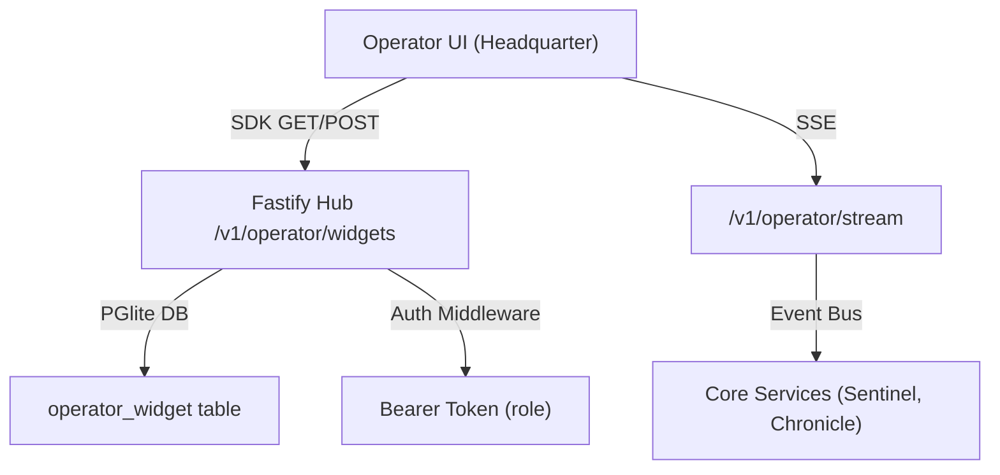

# DESIGN

## UI Architecture
- **Page**: `/operator` under `apps/headquarter` (Next.js App Router).
- **Layout**: Drag‑and‑drop grid (responsive 3‑column on desktop, 1‑column on mobile).
- **Components**: All widgets built from atomic primitives in `@moonwitness/ui` – `Card`, `Chart`, `Table`, `ResizeHandle`, `DragHandle`.
- **State Management**: Global widget store via `@allah/sdk` subscription; persisted layout fetched from backend API.
- **Accessibility**: Keyboard navigation for widget focus, ARIA live region for new alerts.

## Widget Types
| Widget | Purpose | UI Elements |
|--------|---------|--------------|
| **KPI Meter** | Real‑time key performance indicators (throughput, latency) | `StatCard`, `ProgressRing` |
| **Alert Feed** | Live incident list with severity badges | `AlertList`, `Badge` |
| **Topology Map** | Visual network device map with status dots | `NetworkGraph`, `StatusDot` |
| **Custom Chart** | User‑defined line/bar chart via `Chart` component | `Chart` |

## Data Flow Diagram

## Interaction States
- **Loading**: Skeleton cards until layout fetched.
- **Edit Mode**: Drag handles appear; changes saved on exit.
- **Error**: Toast with retry button; UI falls back to read‑only view.
- **Live Updates**: Widget data refreshed via SSE; non‑critical UI updates queued with `requestIdleCallback`.

## Performance Considerations
- Virtualized rendering for large widget grids (React Window).
- Debounce layout persistence (max 1 update per 2 s).
- Limit SSE event rate to 200 events/sec per client.

---

## Acceptance Criteria (Design)
1. UI passes Lighthouse CLS < 0.1.
2. Drag‑and‑drop works with keyboard shortcuts.
3. Widget data reflects backend state within 200 ms latency.
4. All components are imported exclusively from `@moonwitness/ui`.

