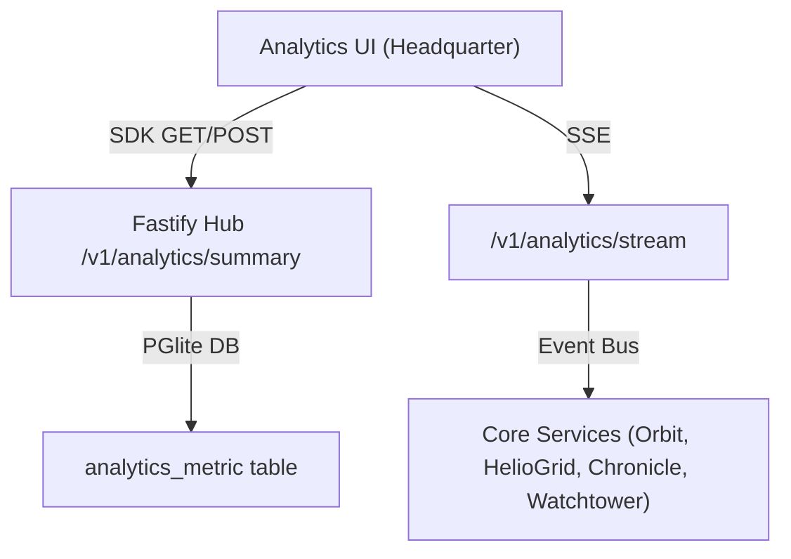

# DESIGN

## UI Architecture
- **Page**: `/analytics` hosted in `apps/headquarter` (Next.js App Router).
- **Layout**: Responsive grid with a top‑level filter toolbar and a main chart area.
- **Components**: All visualizations built from atomic UI primitives in `@moonwitness/ui` – `LineChart`, `BarChart`, `PieChart`, `StatCard`, `DatePicker`, `Select`.
- **State Management**: Global analytics store via `@allah/sdk` that subscribes to SSE stream `/v1/analytics/stream`.
- **Accessibility**: ARIA live region for new data points, keyboard‑navigable filter controls.

## Chart Types
| Chart | Data Source | Key Metrics |
|-------|-------------|------------|
| **Traffic Overview** | `orbit.instance` usage, `sentinel.session` counts | Bandwidth (Gbps), Active Sessions |
| **Energy Consumption** | `heliogrid.inverter`, `heliogrid.battery` | Power (kW), Battery SOC |
| **Incident Heatmap** | `watchtower.alerts` | Severity distribution over time |
| **Custom Metric** | User‑selected via filter | Any aggregation from `analytics_metric` table |

## Data Flow Diagram

## Interaction States
- **Loading**: Skeleton charts while initial summary loads.
- **Filter Applied**: UI shows loading spinner; chart updates via fresh aggregation call.
- **Live Update**: SSE pushes new metric points; chart animates smoothly.
- **Error**: Global toast with retry; UI falls back to last successful snapshot.

## Performance Considerations
- Server‑side aggregation caches results for 30 s to reduce DB load.
- Client‑side debouncing of filter changes (300 ms).
- Virtualized rendering for large data tables (React Window).
- Limit SSE to 200 events/sec per client.

---

## Acceptance Criteria (Design)
1. Page load < 2 s on standard dev workstation (Chrome).
2. Charts update within 5 s of new data arrival.
3. Accessibility tests pass (ARIA, keyboard navigation).
4. All UI components imported exclusively from `@moonwitness/ui`.

