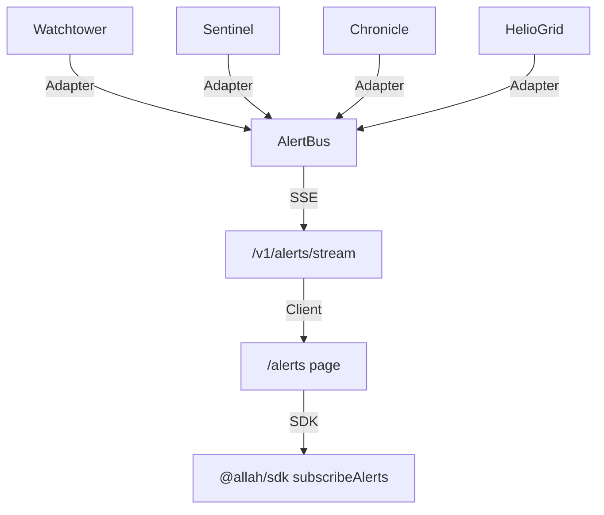

# DESIGN

## Backend Architecture
- **Module** `alertBus.ts` (EventEmitter) lives in `apps/arsy/src/bus/`.
- **Adapters** (`watchtowerAdapter.ts`, `sentinelAdapter.ts`, `chronicleAdapter.ts`, `heliogridAdapter.ts`) translate each service's native event into the canonical `AlertEvent` shape.
- **SSE Endpoint** `GET /v1/alerts/stream` streams JSON‑lines, each line is a serialized `AlertEvent`.
- **Tenant Isolation**: Middleware extracts `company_id` from JWT, creates a scoped `AlertBus` instance per tenant stored in a `Map<string, AlertBus>`.
- **Persistence**: `alert_audit` table (`id`, `company_id`, `payload_hash`, `created_at`) in PGlite; payload stored immutably via SHA‑256.

## Event Schema (`AlertEvent`)
```json
{
  "id": "uuid",
  "timestamp": "ISO8601",
  "severity": "low|medium|high|critical",
  "source": "watchtower|sentinel|chronicle|heliogrid",
  "message": "string",
  "payloadHash": "sha256"
}
```

## Frontend UI
- **Page** `/alerts` (Next.js App Router) in `apps/headquarter/pages/alerts.tsx`.
- **Components** built from `@moonwitness/ui`:
  - `AlertFeed` (virtualized list using `VirtualizedList`).
  - `SeverityBadge` (`Badge` with color mapping).
  - `FilterToolbar` (multiselect dropdown for severity/source, debounced).
- **State**: `useAlertStore` hook from `@allah/sdk` subscribes via `subscribeAlerts(filter)` and stores events in a Redux‑like slice.
- **Accessibility**: ARIA live region `role="alert"` announces new critical alerts.

## Data Flow Diagram


## Performance & Scaling
- **Back‑pressure**: `AlertBus` buffers up to 10 k events per tenant; excess dropped with metric `alert_bus_dropped_events`.
- **Throttling**: Server‑side token bucket (200 events/sec) per client.
- **Load‑balancing**: Fastify can run behind a node cluster; `alertBus` instances are stored in a shared Redis (future improvement) – currently in‑process for dev.

---

## Acceptance Criteria (Design)
1. SSE latency < 150 ms measured from source emission to UI receipt.
2. UI renders new alerts within 100 ms of SSE `message` event.
3. Filter changes do not require reconnection (client‑side re‑filter).
4. All components imported exclusively from `@moonwitness/ui`.
5. ADR documented, docs pass.

