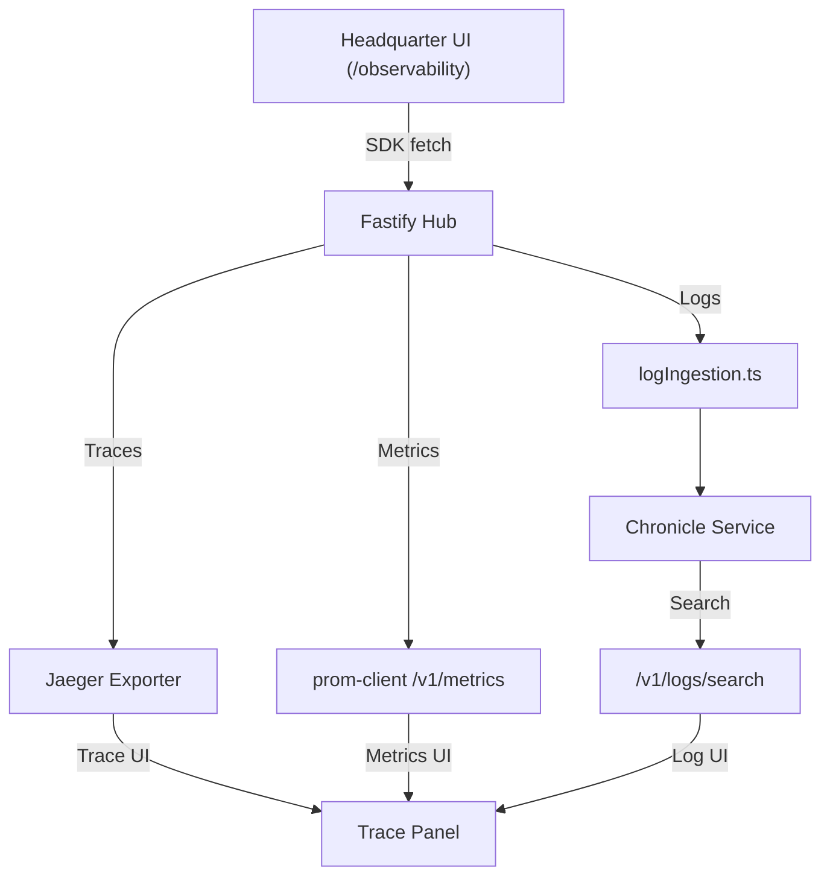

# DESIGN

## Backend Architecture
- **Metrics Module** (`metrics.ts`)
  - Uses `prom-client` to collect default Node.js metrics and custom business KPIs.
  - Exposes gauges for active sessions, SSE latency, DB query time, and per‑tenant request counters.
- **Tracing Module** (`tracing.ts`)
  - OpenTelemetry SDK with Jaeger exporter (`apps/trace-collector`).
  - Auto‑instrument Fastify, HTTP, and PGlite.
  - Propagates `traceId`/`spanId` via HTTP headers.
- **Logging Middleware** (`logIngestion.ts`)
  - Wraps `pino` logger; enriches each log with `company_id`, `requestId`, `traceId`, `spanId`.
  - Streams JSON logs to `apps/chronicle` via an internal Fastify route.
- **Chronicle Service**
  - Receives structured logs, stores immutable entries with SHA‑256 hash in `log_entry` table.
  - Provides `/v1/logs/search` endpoint for UI.

## Observability UI (`/observability` page)
- **Metrics Panel**
  - `LineChart` (CPU, request latency, SSE latency) using `@moonwitness/ui` components.
  - `StatCard` for current active sessions, error rate.
- **Traces Panel**
  - Embeds Jaeger UI via iframe or custom `TraceGraph` component that renders spans using `@moonwitness/ui` `Graph`.
- **Log Search Panel**
  - Virtualized table (`VirtualizedList`) with columns: timestamp, level, message, traceId.
  - Filters: time range, severity, tenant, free‑text search.
- **State Management**
  - SDK hooks (`useMetrics`, `useTraces`, `useLogSearch`) built on `@allah/sdk`.
  - Global store with tenant context; uses `requestIdleCallback` for non‑critical UI updates.

## Data Flow Diagram

## Performance & Scaling
- **Metrics**: Scrape interval 15 s; supports per‑tenant aggregation via label `company_id`.
- **Tracing**: Batch export to Jaeger (5 s flush). Retention 7 days.
- **Logging**: Buffered ingestion (max 5 k logs/sec); back‑pressure via `highWaterMark`.
- **Cache**: In‑process LRU for recent metric queries; metric `observability_cache_hit_ratio`.
- **Monitoring**: Export Prometheus metrics `observability_metrics_export_seconds`, `observability_traces_export_seconds`, `observability_log_ingest_latency_ms`.

---

## Acceptance Criteria (Design)
1. `/v1/metrics` reachable by Prometheus, returns > 50 core metrics.
2. Jaeger UI displays traces for sample requests with < 200 ms latency.
3. Log search returns correct results within 300 ms for 10 k‑row queries.
4. UI panels update in near‑real‑time (metrics refresh ≤ 5 s, logs ≤ 2 s).
5. All components imported exclusively from `@moonwitness/ui`.
6. Documentation and ADR included; `pnpm docs:check` passes.

