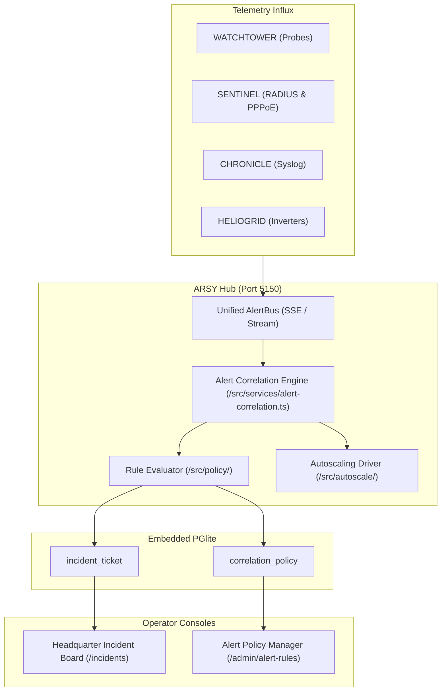

# DESIGN: Observability & Telemetry Platform Phase 2

## 1. System Architecture & Component Interactions
Phase 2 introduces automated alert correlation, policy-driven incident escalation, and reactive autoscaling across the ARSY ecosystem.

## 2. API & Data Contracts
- `POST /v1/incidents/correlate`: Real-time ingestion buffer for batch evaluation.
- `GET /v1/incidents`: Paginated active incident tickets filtered by tenant and severity.
- `POST /v1/incidents/:id/ack`: Idempotent acknowledgment endpoint with operator audit recording.
- `POST /v1/policies/alert-rules`: Create or update JSON-based correlation rule expressions.

## 3. UI/UX Interaction Layout
- High-density Kanban board in `apps/headquarter/src/app/incidents/page.tsx`.
- Visual rule builder using `@moonwitness/ui` atomic elements (`Card`, `Input`, `Select`, `Badge`).
- Live SSE sync displaying incident timeline graphs with zero layout shift.
