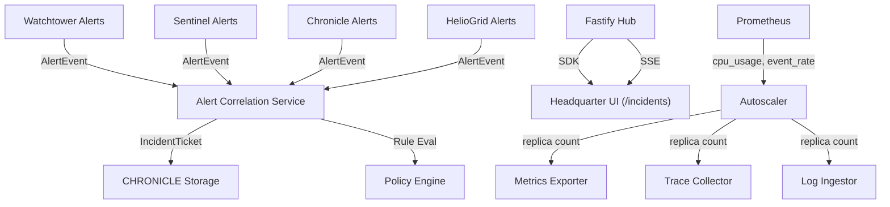

# DESIGN

## Backend Architecture
- **Alert Correlation Service** (`apps/arsy/src/services/alert-correlation.ts`)
  - Consumes `AlertEvent` stream from Watchtower, Sentinel, Chronicle, and HelioGrid.
  - Applies configurable rule-sets per tenant via the Policy Engine.
  - Emits `IncidentTicket` objects stored in `CHRONICLE` with severity escalation.
- **Policy Engine** (`apps/arsy/src/policy/`)
  - JSON-based correlation rules (e.g., ">3 critical alerts within 2 min -> create incident").
  - Rule evaluation runs on a sliding window with configurable thresholds.
- **Autoscaling Infrastructure**
  - Metrics exporter, tracing collector, and log ingestion deployed as Kubernetes Deployments (simulated via Docker Compose for dev).
  - Horizontal Pod Autoscaler-like logic driven by Prometheus metrics (`cpu_usage`, `event_rate`).
- **Incident Management API**
  - Endpoints for listing, acknowledging, and resolving incident tickets.
  - Real-time push via SSE for incident state changes.

## Observability UI (`/incidents` page)
- **Incident Dashboard**
  - Stat cards for open, acknowledged, and resolved incidents.
  - Timeline view of incident events with severity color coding.
  - Acknowledge / resolve actions bound to SDK methods.
- **Alert Rule Editor** (`/admin/alert-rules`)
  - JSON rule editor with syntax highlighting.
  - Rule templates for common correlation patterns.
- **Autoscaling Monitor**
  - Live replica count and CPU usage charts per observability service.

## Data Flow Diagram

## Performance & Scaling
- **Correlation**: Evaluates 1,000 alerts/sec with <50 ms latency per rule set.
- **Autoscaling**: Scale-out latency <30 s; scale-in cooldown 60 s.
- **Incident API**: List latency <200 ms for 10 k rows with pagination.
- **SSE**: One connection per operator; heartbeat every 30 s.

---

## Acceptance Criteria (Design)
1. Correlation engine generates incident tickets meeting defined rule thresholds.
2. Autoscaling adjusts replica count within ±10 % of target CPU/utilization under load.
3. Incident UI displays real-time ticket list with acknowledgement flow.
4. Only `admin` role can create/modify correlation policies; `operator` can acknowledge tickets.
5. All quality gates pass (docs, lint, typecheck) and `pnpm docs:check` remains 100 / 100.