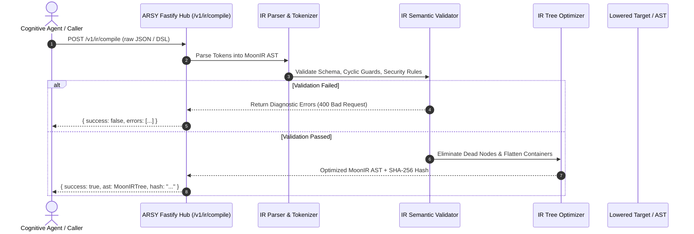

# DESIGN: IR Translation Phase 1 — Canonical Semantic AST & Multi-Target IR Schema

## 1. Architectural Representation & Pipeline Flow
The Intermediate Representation (IR) is the single canonical truth bridge connecting cognitive agent synthesis, ORM structures, and client runtime execution targets.



## 2. Canonical AST Node Anatomy (`MoonIRNode`)
```json
{
  "$schema": "https://moonwitness.io/schemas/moon-ir-v1.json",
  "version": "1.0.0",
  "id": "node_98f12a",
  "kind": "container",
  "name": "dashboard_overview",
  "attributes": {
    "layout": "grid",
    "columns": 3,
    "gap": 16
  },
  "bindings": {
    "tenantId": "context.company_id"
  },
  "children": [
    {
      "id": "node_98f12b",
      "kind": "data_binding",
      "name": "active_sessions_metric",
      "attributes": {
        "source": "sentinel.sessions.count",
        "refreshIntervalMs": 5000
      }
    }
  ],
  "metadata": {
    "author": "ArsyPlannerAgent",
    "hash": "e3b0c44298fc1c149afbf4c8996fb92427ae41e4649b934ca495991b7852b855"
  }
}
```

## 3. UI/UX & Diagnostic Contract
- When validation fails, the IR compiler returns structured diagnostic arrays containing:
  - `code`: Machine-readable code (e.g. `ERR_IR_CYCLIC_DEPENDENCY`, `ERR_INVALID_PROPERTY_TYPE`).
  - `path`: JSON pointer to the offending node (e.g. `/children/2/attributes/source`).
  - `message`: Clear, actionable explanation without slop.

