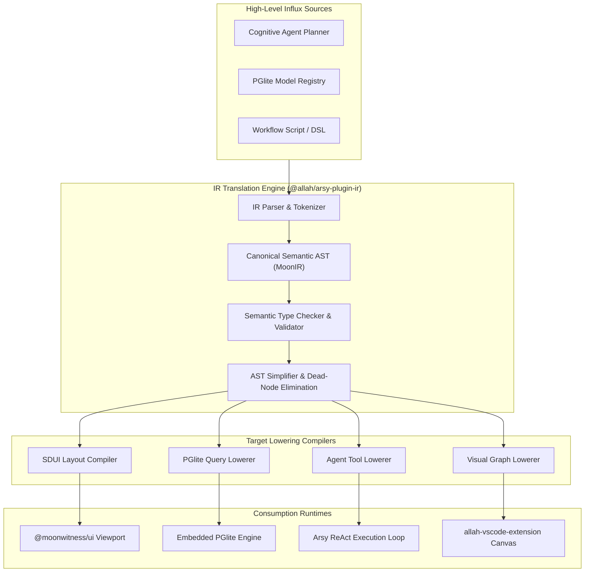

# SPEC: IR Translation Phase 1 — Canonical Semantic AST & Multi-Target IR Schema

## 1. Context & Architecture Goal
- **IR Translation Problem**: Cognitive agent systems, ORM schemas, and dynamic business domain engines in A-L-L-A-H.COM output heterogeneous representations (JSON schemas, raw SQL, ReAct steps, DSL queries, visual blueprints).
- **Core Mission**: Establish an **Intermediate Representation (IR)** compilation pipeline that transforms high-level cognitive intentions and domain models into an immutable, type-safe Abstract Syntax Tree (AST), which can then be deterministically lowered into multiple target execution formats.
- **Backend Hub Integration**: IR Translation engine resides as a core modular package `@allah/arsy-plugin-ir` and integrates natively into the Fastify Hub (`apps/arsy:5150`).
- **Target Lowering Channels**:
  1. `Target: SDUI-Tree` (Generative UI for React 19).
  2. `Target: PGlite-SQL` (Parameterized safe SQL execution).
  3. `Target: Agent-Action` (Autonomous tool calling and state updates).
  4. `Target: Flow-Graph` (Interactive visual workflow graphs for IDE & Consoles).

---

## 2. Requirements & Deliverables

### 2.1 Canonical Semantic AST Definition (`@moonwitness/types/ir`)
1. Strict schema definition for `MoonIRNode`:
   - `IRNode`: `type`, `id`, `kind`, `attributes`, `bindings`, `children`, `metadata`.
   - Node Kinds: `ContainerNode`, `DataBindingNode`, `ActionNode`, `ConditionNode`, `VisualizationNode`.
2. AST Serialization and Deserialization helpers with SHA-256 integrity hash verification.

### 2.2 IR Compilation & Validation Engine (`packages/arsy-plugin-ir`)
1. **Parser**: Translates input JSON / DSL / Agent intent payloads into `MoonIRAST`.
2. **Validator**: Schema validation, tenant isolation check, circular reference guard, and property type assertions.
3. **AST Optimizer**: Eliminates unreachable nodes, flattens trivial nested containers, and pre-resolves static binding values.

### 2.3 Fastify Hub Endpoints (`apps/arsy`)
- `POST /v1/ir/compile`: Compiles input JSON/DSL to canonical IR AST and returns diagnostics.
- `POST /v1/ir/validate`: Validates an IR AST against security policies and schema invariants.

---

## 3. Acceptance Criteria
1. Compilation of 1,000 IR nodes completes in $< 15\text{ms}$ with zero memory leaks.
2. Validates and rejects malformed AST payloads with actionable diagnostic error codes.
3. Strict TypeScript compilation passes across `@moonwitness/types` and `@allah/arsy-plugin-ir`.
4. Monorepo quality gates (`pnpm docs:check`, `pnpm lint:arch`, `pnpm typecheck`) pass 100%.

